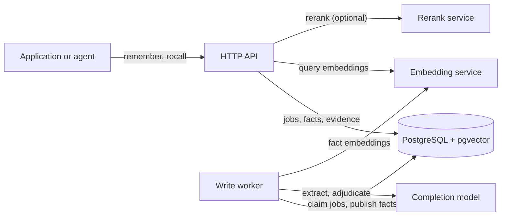

# MnemoTrace

**Long-term memory for LLM agents. Every fact carries a time and a source.**

[English](README.md) · [简体中文](README.zh-CN.md)

[](https://github.com/NotZhu/MnemoTrace/actions/workflows/backend-ci.yml)
[](https://github.com/NotZhu/MnemoTrace/actions/workflows/ci.yml)
[](LICENSE)
[](pyproject.toml)

MnemoTrace is an open-source, self-hosted memory engine for LLM agents. It
turns conversation history into facts that record **when they were true** and
**which messages support them**, so an agent can answer both “what is true
now?” and “what did we believe last month, and why?”

Applications write messages with `remember`; a background worker extracts facts,
reconciles them with existing facts, and commits the result. Before answering,
the application calls `recall` for the facts that apply at the requested time,
with validity intervals and source message IDs.

> **Status:** `0.1.0` (pre-1.0). The HTTP API, storage schema, and configuration
> may change without backward-compatibility guarantees. See
> [Project status](#project-status).

## Contents

- [When a correction arrives later](#when-a-correction-arrives-later)
- [Three questions](#three-questions)
- [Architecture](#architecture)
- [Quickstart](#quickstart)
- [Use the API](#use-the-api)
- [Documentation](#documentation)
- [Development checks](#development-checks)
- [Project status](#project-status)
- [Contributing](#contributing)
- [License](#license)

## When a correction arrives later

On October 1, a user says: “Starting today, I take the subway to work on
weekdays.” On November 3, in another session, they say: “I switched to biking
starting November 1.”

MnemoTrace accepts the November 3 write and records the biking fact as valid from
November 1. The write is recorded on November 3; the change is effective on
November 1. The subway fact ends on November 1 but is not deleted.

| `recall` with `as_of` | Returns                      | Evidence           |
| --------------------- | ---------------------------- | ------------------ |
| October 31            | Takes the subway on weekdays | October 1 message  |
| November 1            | Bikes to work on weekdays    | November 3 message |

Both answers remain available, each with `source_message_ids`. The three
questions below explain how that works; a fourth covers deletion.

## Three questions

**“What did they say last month?”**

`as_of` filters by when a fact was valid, not by when it was written. In the
example above, the November correction does not change the October 31 answer; the
old fact keeps its ID and validity interval, and the audit trail records the
change. This is a bitemporal model: business validity and record time are
stored separately.

**“Where did this conclusion come from?”**

Every extracted fact is linked to the messages that produced it. `recall` returns
`source_message_ids` that point to the original messages, and the audit API shows
the interval before and after each change and which fact triggered the close.

**“The write timed out. Will it be duplicated?”**

`remember` persists the job before calling a model. Replaying the same request
with the same `Idempotency-Key` returns the original job; it does not write
twice. If a worker crashes, its lease expires and another worker can claim the
job if attempts remain. Messages, fact changes, and job status commit in one
transaction.

**One more: what happens when a user asks for deletion?**

Erasing a session removes the evidence groups that depend on its messages; facts
with independent evidence remain. The four deletion scopes (fact, session, space
purge, space deletion) are described in the
[data lifecycle guide](docs/guides/data-lifecycle.md).

The first three questions correspond to `as_of`, `source_message_ids`, and
`Idempotency-Key`; the regression tests for writes, fact lifecycle, and erasure
are listed in the
[memory engine architecture](docs/architecture/memory.md#验证依据).

## Architecture

MnemoTrace has two long-running processes and one database: the API accepts
writes and serves queries; the worker does model work; both share PostgreSQL with
pgvector.



**Write path.** The API persists a write job and returns `202`. The worker claims
the job, extracts facts, and compares candidates outside the space write lock.
Before publishing, it rechecks fact versions, erasure state, and the session
under the lock. It then commits messages, fact changes, and job status in one
transaction.

**Read path.** Build a visible candidate set for the space and time, fuse
lexical, vector, and optional graph rankings with Reciprocal Rank Fusion (RRF),
optionally rerank, and trim to `top_k` and `max_evidence_chars`.

Core objects: a **space** scopes memory and access; a **session** groups ordered
messages; a **fact** has a subject, predicate, object, and validity interval; an
**evidence group** links a fact to its source messages; an **operation** is a
write job.

Models extract and judge; the backend owns authorization, time, evidence, and
transactions. The data model, concurrency details, and consistency boundaries are
in the [memory engine architecture](docs/architecture/memory.md).

## Quickstart

Run the commands below from the repository root. The bundled deployment targets
Docker Compose 2.30 or later and needs a completion endpoint plus an embedding
endpoint.

| Requirement | Notes |
| --- | --- |
| Docker Compose 2.30+ | Required by the bundled deployment. |
| Completion and embedding endpoints | OpenAI-compatible Chat Completions and Embeddings. |
| `uv` | Runs the smoke test and the development checks. |
| Reranker (optional) | Cohere v2-compatible endpoint. |

1. Configure the database and model endpoints. Use an empty database volume for
   the first deployment.

   ```sh
   cp deploy/.env.example .env
   cp deploy/.env.models.example deploy/.env.models
   ```

   Set `MNEMOTRACE_DB_PASSWORD` in `.env` to a random hexadecimal value
   (`openssl rand -hex 32` generates one). Fill in `MNEMOTRACE_LLM_*` and
   `MNEMOTRACE_EMBED_*` in `deploy/.env.models`; see
   [Model configuration](docs/reference/model-configuration.md).

2. Start the service and initialize the local account.

   ```sh
   docker compose --env-file .env -f deploy/compose.yaml up --build --wait
   docker compose --env-file .env -f deploy/compose.yaml run --rm admin bootstrap
   ```

   `bootstrap` creates a space named `default` and prints a `token` and
   `space_id`. The database stores only a hash of the token, so keep it in a
   credential store.

3. Verify the deployment with synthetic data.

   ```sh
   MNEMOTRACE_SMOKE_TOKEN='<token>' uv run --locked python scripts/http_smoke.py
   ```

   The script writes synthetic messages, verifies that recalled evidence traces
   back to the original messages, and removes the space it created. A successful
   run prints `HTTP smoke test passed; test space removed.` If you changed the
   API port, pass the actual address with `--base-url`.

The API listens on `http://127.0.0.1:8100` by default. For production
deployment, backups, key rotation, and troubleshooting, see the
[self-hosting guide](deploy/README.md).

## Use the API

The example below creates a session, submits a message batch, and recalls
evidence. It assumes `curl` and Python 3; replace the placeholders with the
`token` and `space_id` from `bootstrap`.

```bash
BASE_URL=http://127.0.0.1:8100
API_KEY='<token>'
SPACE_ID='<space_id>'

SESSION_ID=$(curl -fsS -X POST "$BASE_URL/v1/spaces/$SPACE_ID/sessions" \
  -H "Authorization: Bearer $API_KEY" \
  | python3 -c 'import json, sys; print(json.load(sys.stdin)["session_id"])')

OPERATION_ID=$(curl -fsS -X POST "$BASE_URL/v1/spaces/$SPACE_ID/sessions/$SESSION_ID/remember" \
  -H "Authorization: Bearer $API_KEY" \
  -H "Content-Type: application/json" \
  -H "Idempotency-Key: $(python3 -c 'import uuid; print(uuid.uuid4().hex)')" \
  -d '{"messages":[{"role":"user","content":"Starting October 1, 2026, I take the subway to work on weekdays."}]}' \
  | python3 -c 'import json, sys; print(json.load(sys.stdin)["operation_id"])')

# Poll GET /v1/spaces/$SPACE_ID/operations/$OPERATION_ID until status is "succeeded", then:
curl -fsS -X POST "$BASE_URL/v1/spaces/$SPACE_ID/recall" \
  -H "Authorization: Bearer $API_KEY" \
  -H "Content-Type: application/json" \
  -d '{"query":"How do I commute to work?","top_k":3,"max_evidence_chars":600}'
```

`remember` returns `202 Accepted` with an `operation_id`. Poll
`GET /v1/spaces/{space_id}/operations/{operation_id}` until `status` is
`succeeded`, then call `recall`. An abridged response:

```json
{
  "evidence": [
    {
      "fact_id": "…",
      "text": "Takes the subway to work on weekdays.",
      "valid_at": "2026-10-01T00:00:00Z",
      "invalid_at": null,
      "source_message_ids": ["…"],
      "relation": null
    }
  ],
  "degraded_reason": null,
  "rerank_applied": false,
  "truncated": false
}
```

`source_message_ids` points to the original messages; fetch one with
`GET /v1/spaces/{space_id}/messages/{message_id}`. `valid_at` and `invalid_at`
are the business-time interval, while `degraded_reason`, `rerank_applied`, and
`truncated` report how the result was produced.

`as_of` queries a past point in time. `filters` narrows by source and labels,
`graph` enables entity expansion, `rerank` controls the optional reranker, and
`prefer_recent` gives a small boost to recently valid facts when `as_of` is
omitted. The
[HTTP API guide](docs/reference/http-api.md#召回选项) covers the full request
contract, idempotent retry, pagination, and error codes. For Node.js, the
repository includes a [TypeScript SDK](clients/typescript/README.md).

## Documentation

The detailed guides are currently written in Simplified Chinese; English
translations are welcome.

| Task | Guide |
| --- | --- |
| Integrate over HTTP | [HTTP API v1](docs/reference/http-api.md) |
| Use the TypeScript SDK | [TypeScript SDK](clients/typescript/README.md) |
| Self-host, back up, rotate keys | [Self-hosting](deploy/README.md) |
| Understand the data model and consistency boundaries | [Memory engine architecture](docs/architecture/memory.md) |
| Browse all documentation | [Documentation index](docs/README.md) |

The full index also covers model configuration, data lifecycle, and evaluation.

## Development checks

```sh
uv sync --locked
uv run --locked python scripts/check.py
```

`check.py` runs Ruff lint and format checks, strict mypy, and pytest. Database
integration tests use a dedicated PostgreSQL/pgvector instance:

```sh
MNEMOTRACE_TEST_POSTGRES_DSN='postgresql://…' uv run --locked pytest -m postgres
```

CI runs the same checks against a PostgreSQL 18/pgvector service and verifies
the TypeScript SDK, console, and website builds.

## Project status

- Current version: `0.1.0` (pre-1.0). The project does not yet promise backward
  compatibility; API and schema changes may require updating clients or
  reinitializing a development database from the current baseline.
- The HTTP contract is published as an OpenAPI document
  (`GET /openapi.json`). The TypeScript SDK types are generated from it and
  checked in CI.
- `main` is the supported branch. Report vulnerabilities privately as described
  in [SECURITY.md](SECURITY.md).

## Contributing

Bug reports, feature proposals, and pull requests are welcome. Read
[CONTRIBUTING.md](CONTRIBUTING.md) for the issue and pull request workflow. Use
synthetic data in examples and logs, and remove credentials before posting.
Report security issues through the private channel in
[SECURITY.md](SECURITY.md).

## License

MnemoTrace is released under the [GNU Affero General Public License v3.0](LICENSE)
(`AGPL-3.0-only`).
