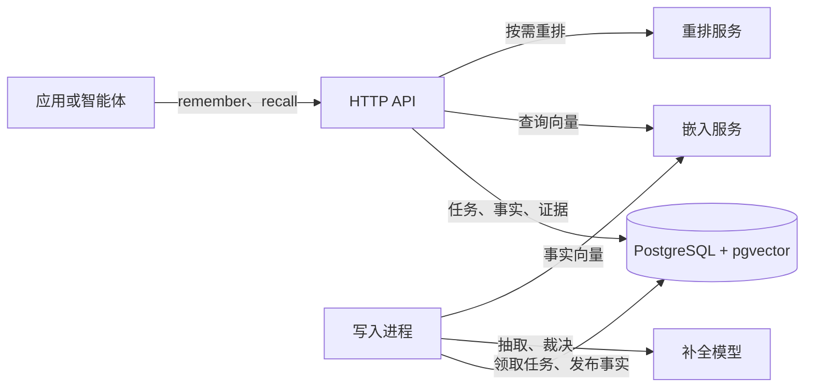

# MnemoTrace · 忆痕

**面向 LLM 智能体的长期记忆。每条事实都带时间和来源。**

[English](README.md) · [简体中文](README.zh-CN.md)

[](https://github.com/NotZhu/MnemoTrace/actions/workflows/backend-ci.yml)
[](https://github.com/NotZhu/MnemoTrace/actions/workflows/ci.yml)
[](LICENSE)
[](pyproject.toml)

MnemoTrace 是面向 LLM 智能体的开源、自托管记忆引擎。它把对话历史变成同时保留**有效时间**和**原文依据**的事实，让智能体既能回答“现在什么成立”，也能回答“上个月我们相信什么，依据是什么”。

应用用 `remember` 写入消息，后台写入进程提炼事实、与已有事实比对并处理冲突，然后提交结果。回答前，应用调用 `recall`，取回在指定时点有效的事实、有效期和原文消息 ID。

> **状态：** `0.1.0`（1.0 之前）。HTTP API、存储结构和配置可能变化，不承诺向后兼容。详见[项目状态](#项目状态)。

## 目录

- [时间变了，答案怎么变](#时间变了答案怎么变)
- [三个问题](#三个问题)
- [架构](#架构)
- [快速开始](#快速开始)
- [调用 API](#调用-api)
- [文档](#文档)
- [开发验证](#开发验证)
- [项目状态](#项目状态)
- [参与贡献](#参与贡献)
- [许可证](#许可证)

## 时间变了，答案怎么变

10 月 1 日，用户说：“从今天起，我工作日坐地铁上班。”11 月 3 日，用户在另一场会话里说：“从 11 月 1 日起，我改骑车上班了。”

MnemoTrace 在 11 月 3 日受理这次写入，把骑车事实记为从 11 月 1 日起有效。写入的记录时间是 11 月 3 日，变更的生效时间是 11 月 1 日。地铁事实在 11 月 1 日截止，但不会被删除。

| `recall` 的 `as_of` | 返回             | 依据             |
| ------------------- | ---------------- | ---------------- |
| 10 月 31 日         | 工作日坐地铁上班 | 10 月 1 日的消息 |
| 11 月 1 日          | 工作日骑车上班   | 11 月 3 日的消息 |

两个答案都能查到，并且各自带着 `source_message_ids`。下面三个问题解释这个行为是怎么做到的，最后再补一个删除场景。

## 三个问题

**“上个月用户怎么说？”**

`as_of` 按事实的生效时间查询，不按写入时间。上面的例子里，11 月改口不会改写 10 月 31 日的答案；旧事实的 ID 和有效期保留，变更审计记录这次变化。这就是双时间轴模型：业务有效时间和系统记录时间分开保存。

**“这条结论从哪来？”**

每条抽取事实都关联产生它的原文。`recall` 返回的 `source_message_ids` 指向原文，可以直接读回消息；审计接口给出每次变更前后的有效期，以及是哪条事实触发了截止。

**“写入超时了，会不会重复？”**

`remember` 先把任务落库，再调用模型。用原请求和原 `Idempotency-Key` 重放，拿到的是原任务，不会重复写入。写入进程崩溃后，租约到期，有剩余尝试次数的任务由其他进程接管；原文、事实变更和任务状态在同一事务提交。

**还有一个问题：用户要求删除数据怎么办？**

擦除会话会移除依赖该会话原文的证据组；仍有独立证据的事实保留。四种删除范围（删事实、擦除会话、清空空间、删空间）见[数据生命周期指南](docs/guides/data-lifecycle.md)。

前三个问题分别对应 `as_of`、`source_message_ids` 和 `Idempotency-Key`；写入、事实生命周期和擦除的回归测试入口见[记忆引擎架构](docs/architecture/memory.md#验证依据)。

## 架构

MnemoTrace 由两个常驻进程和一个数据库组成：API 接收写入、提供查询；写入进程承担模型工作；两者共用 PostgreSQL 和 pgvector。



**写入路径。** API 保存写入任务后返回 `202`。写入进程领取任务，在空间写锁之外抽取事实并比对候选。提交前，它在锁内复核事实版本、擦除状态和会话，然后在同一事务中写入原文、事实变更和任务状态。

**读取路径。** 按空间和时点构造可见候选，用倒数排名融合（RRF）合并词法、向量和可选图排序；按需重排；最后按 `top_k` 和 `max_evidence_chars` 裁剪。

核心对象：**空间**划定记忆与访问范围；**会话**组织有序消息；**事实**包含主体、谓词、对象和有效期；**证据组**把事实关联到原文；**任务**是一次写入作业。

模型负责抽取和语义判断，后端负责鉴权、时间、证据和事务。数据模型、并发细节和一致性边界见[记忆引擎架构](docs/architecture/memory.md)。

## 快速开始

以下命令从仓库根目录运行。内置部署需要 Docker Compose 2.30 或更高版本，以及一个补全端点和一个嵌入端点。

| 依赖                 | 说明                                           |
| ---------------------- | ------------------------------------------------ |
| Docker Compose 2.30+ | 内置部署需要。                                 |
| 补全与嵌入端点       | OpenAI 兼容的 Chat Completions 与 Embeddings。 |
| `uv`                 | 运行验收脚本和开发验证。                       |
| 重排服务（可选）     | Cohere v2 兼容端点。                           |

1. 配置数据库和模型端点。首次部署使用空数据库卷。

   ```sh
   cp deploy/.env.example .env
   cp deploy/.env.models.example deploy/.env.models
   ```

   在 `.env` 中为 `MNEMOTRACE_DB_PASSWORD` 填写随机十六进制密码（可用 `openssl rand -hex 32` 生成）。在 `deploy/.env.models` 中填写 `MNEMOTRACE_LLM_*` 和 `MNEMOTRACE_EMBED_*`，字段说明见[模型配置参考](docs/reference/model-configuration.md)。
2. 启动服务并初始化本地账号。

   ```sh
   docker compose --env-file .env -f deploy/compose.yaml up --build --wait
   docker compose --env-file .env -f deploy/compose.yaml run --rm admin bootstrap
   ```

   `bootstrap` 创建名为 `default` 的空间，输出 `token` 和 `space_id`。数据库只保存密钥校验值，请把 `token` 存入凭据存储。
3. 用合成数据验证部署。

   ```sh
   MNEMOTRACE_SMOKE_TOKEN='<token>' uv run --locked python scripts/http_smoke.py
   ```

   脚本写入合成消息，验证召回证据可以追溯到原文，并清理本次创建的验收空间。成功运行后会输出 `HTTP smoke test passed; test space removed.` 如果修改了 API 端口，用 `--base-url` 指定实际地址。

API 默认监听 `http://127.0.0.1:8100`。生产部署、备份、密钥轮换和故障排查见[自托管部署与运维](deploy/README.md)。

## 调用 API

下面的示例创建会话、提交一批消息并召回证据。命令需要 `curl` 和 Python 3；把占位符换成 `bootstrap` 返回的 `token` 和 `space_id`。

```bash
BASE_URL=http://127.0.0.1:8100
API_KEY='<token>'
SPACE_ID='<space_id>'

SESSION_ID=$(curl -fsS -X POST "$BASE_URL/v1/spaces/$SPACE_ID/sessions" \
  -H "Authorization: Bearer $API_KEY" \
  | python3 -c 'import json, sys; print(json.load(sys.stdin)["session_id"])')

OPERATION_ID=$(curl -fsS -X POST "$BASE_URL/v1/spaces/$SPACE_ID/sessions/$SESSION_ID/remember" \
  -H "Authorization: Bearer $API_KEY" \
  -H "Content-Type: application/json" \
  -H "Idempotency-Key: $(python3 -c 'import uuid; print(uuid.uuid4().hex)')" \
  -d '{"messages":[{"role":"user","content":"从 2026 年 10 月 1 日起，我工作日坐地铁上班。"}]}' \
  | python3 -c 'import json, sys; print(json.load(sys.stdin)["operation_id"])')

# 轮询 GET /v1/spaces/$SPACE_ID/operations/$OPERATION_ID，status 为 succeeded 后：
curl -fsS -X POST "$BASE_URL/v1/spaces/$SPACE_ID/recall" \
  -H "Authorization: Bearer $API_KEY" \
  -H "Content-Type: application/json" \
  -d '{"query":"我工作日怎么上班？","top_k":3,"max_evidence_chars":600}'
```

`remember` 返回 `202 Accepted` 和 `operation_id`。轮询 `GET /v1/spaces/{space_id}/operations/{operation_id}`，直到 `status` 为 `succeeded`，再调用 `recall`。一次成功的召回响应节选如下：

```json
{
  "evidence": [
    {
      "fact_id": "…",
      "text": "工作日坐地铁上班。",
      "valid_at": "2026-10-01T00:00:00Z",
      "invalid_at": null,
      "source_message_ids": ["…"],
      "relation": null
    }
  ],
  "degraded_reason": null,
  "rerank_applied": false,
  "truncated": false
}
```

`source_message_ids` 指向原文，可用 `GET /v1/spaces/{space_id}/messages/{message_id}` 读取。`valid_at` 和 `invalid_at` 是业务有效区间；`degraded_reason`、`rerank_applied` 和 `truncated` 分别说明降级、重排和预算裁剪情况。

`as_of` 用于查询历史时点。`filters` 按来源和标签筛选，`graph` 启用实体扩展，`rerank` 控制可选重排，`prefer_recent` 在省略 `as_of` 时为近期生效的事实小幅加分。完整请求契约、幂等重试、分页和错误码见 [HTTP API 接入指南](docs/reference/http-api.md#召回选项)。Node.js 应用可以使用仓库内的 [TypeScript SDK](clients/typescript/README.md)。

## 文档

详细指南目前以简体中文撰写；欢迎贡献英文翻译。

| 任务 | 文档 |
| --- | --- |
| 通过 HTTP 接入 | [HTTP API v1 接入指南](docs/reference/http-api.md) |
| 使用 TypeScript SDK | [TypeScript SDK](clients/typescript/README.md) |
| 自托管、备份、轮换密钥 | [自托管部署与运维](deploy/README.md) |
| 理解数据模型和一致性边界 | [记忆引擎架构](docs/architecture/memory.md) |
| 浏览全部文档 | [文档索引](docs/README.md) |

完整索引还包括模型配置、数据生命周期和评测。

## 开发验证

```sh
uv sync --locked
uv run --locked python scripts/check.py
```

`check.py` 依次运行 Ruff 检查与格式校验、严格 mypy 和 pytest。真库回归使用独立的 PostgreSQL/pgvector 实例：

```sh
MNEMOTRACE_TEST_POSTGRES_DSN='postgresql://…' uv run --locked pytest -m postgres
```

CI 运行同一套检查，并用 PostgreSQL 18/pgvector 服务执行集成测试；TypeScript SDK、控制台和官网由另一条 CI 校验。

## 项目状态

- 当前版本 `0.1.0`（1.0 之前），尚未承诺向后兼容。API 和存储结构变化时，客户端可能需要同步更新，开发数据库可能需要从当前基线重新初始化。
- HTTP 契约以 OpenAPI 文档形式发布（`GET /openapi.json`）。TypeScript SDK 类型由它生成，并在 CI 中校验。
- `main` 是当前维护分支。安全问题请按[安全政策](SECURITY.md)私下报告。

## 参与贡献

欢迎提交缺陷、功能建议和 Pull Request。流程见[贡献指南](CONTRIBUTING.md)。示例和日志使用合成数据，提交前移除凭据。漏洞请通过[安全政策](SECURITY.md)列出的私密渠道报告。

## 许可证

MnemoTrace 以 [GNU Affero 通用公共许可证第 3 版](LICENSE)（`AGPL-3.0-only`）发布。
