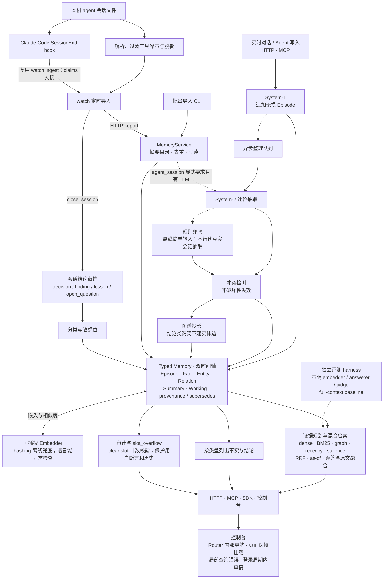

# 忆痕架构优化地图

本文按架构层记录优化目标、已采用的取舍、验证证据与后续方向。完整对象生命周期和接口说明见
[全链路架构报告](mnemotrace-full-architecture-report.zh-CN.md)，缺陷状态统一维护在
[问题台账](known-issues.zh-CN.md)。公开成绩以 [RESULTS.md](../RESULTS.md) 和已提交的原始日志为准。

## 0. 阅读入口

| 你想看什么 | 位置 |
| --- | --- |
| 两条写入路径和共用核心 | 第 1 节总览图 |
| 下一步值得优化什么 | 第 2 节当前重点区域 |
| 算法的关键约束和参数 | 第 3 节算法流程与承重参数 |
| 某个模块为什么这样实现、证据在哪里 | 第 4 节按模块组织的优化台账 |
| 哪些方案已被替代、哪些收益尚不成立 | 第 5 节未采用／回滚原因 |
| 改动需要什么验证、文档如何更新 | 第 6～7 节 |
| 代码、规格与结果入口 | 第 8 节快速定位 |

优化台账描述“原因 → 取舍 → 证据”，架构报告描述当前实现。表中的实验链接只证明对应运行及其
验证范围；离线测试、个人记忆检查、切片实验和完整 benchmark 不能互相替代。

## 1. 总览图

实时对话与批量 agent 会话共享 Typed Memory、MemoryService 和读取链路，但采用不同的抽取成本策略。
图中虚线表示条件分支。延迟目标见项目宪章，图中的模块连接不构成性能验收。



agent_session 默认只存储、摘要与结论收尾，不把无 LLM 的逐轮规则抽取当作真实会话理解。
benchmark 的配置和调用路径需要单独声明，不能用未经过 `close_session` 的跑分证明结论蒸馏质量。

## 2. 当前重点区域

| 优先级 | 模块 | 原因与下一步 | 验证边界 |
| --- | --- | --- | --- |
| P0 | Raw evidence fusion | facts-only 丢失原文细节；继续将 raw chunks、facts、graph paths、summary/provenance 证据类型化，减少重复与噪声 | 读路径消融、真实错例切片、tokens 与延迟；证据过宽状态见[问题台账](known-issues.zh-CN.md) |
| P0 | Chain-aware retrieval | 已支持 previous-value 源会话提升；扩展到多段属性演化与 profile-level chain | 区分当前值和历史值的完整证据链 |
| P1 | Graph proximity / multi-hop | 强化跨会话关联；先用真实错例验证轻量 n-hop 或 PPR-style expansion | 代理 recall 提升不能代替最终 QA 质量 |
| P1 | Temporal interval reasoning | 补足 start/end pair、invalid_at span 与 duration/date arithmetic 证据 | 保留原文时间精度；按具体类别和 rig 比较 baseline |
| P1 | 用户归属一致性 | 读取、审计与删除精确匹配相同的原始 user_id；不合并编号 | 姓名共指与用户编号隔离分别验证，保护历史和其他用户数据 |
| P2 | Runtime profiles | 将 embedder、extractor、语言和读取策略绑定为可测配置，使被测组合对应实际使用组合 | 每个 profile 用相同 harness 报 accuracy、tokens、p50/p95 latency |

benchmark 路径优先推进原文融合、演化链和多跳；个人记忆路径重点是导入质量、来源与身份一致性。
agent_session 的抽取门、watch/hook 调度和 embedder 能力体检已有实现，不重复列作待开发功能。
具体缺陷、兼容收束和状态见[问题台账](known-issues.zh-CN.md)，包括
[存储与接口收束事项](known-issues.zh-CN.md)。这些方向是待验证的优化目标，不表示已经落地。

控制台的信息组织以“决定过什么、什么仍未解决、哪些内容需要纠正”为依据；页面合并需要实际使用证据，
不能仅因存储中存在一种对象就增加一个页面，也不能仅凭主观判断删除现有入口。

## 3. 算法流程与承重参数

参数以 [Config](../mnemotrace/config.py) 及对应算法实现为准。下表包含默认值、调用参数和内部常量，
不代表每次运行都会走完全部分支；benchmark 必须保存实际配置。

| 算法 | 代码 | 流程与约束 | 承重参数 |
| --- | --- | --- | --- |
| search 决策级联 | `memory.py::search()` | 多跳规划 → supersedes 历史链 → 规程 → 混合检索；未命中再检查冷层、规程、摘要与弃答。规划链来自本用户谓词/实体，答案需通过类型对齐 | `top_k=5`、`max_hops=2`、`abstain_threshold=0.45`；只匹配实体名不能替代属性依据 |
| 五路信号融合 | `retrieve/hybrid.py`、`fusion.py` | live/槽头/图排除区过滤后，对语义、词法、图邻近、新近度和 salience 分别排名，再做加权 RRF；类型倍率只作用于真实 embedder 的语义分 | 权重 `1.0/0.6/0.8/0.3/0.25`；`rrf_k=60`、`recency_tau_days=45`、类型倍率 `1.25/1.15`；图逐跳衰减 `0.65` |
| 上下文装配 | `retrieve/evidence.py`、`memory.py::lean_context()` | 按证据形态分预算：persona → working → facts → summaries → detail 原文 → aggregation → timeline → 硬顶；已提升为 detail 的会话不重复放摘要 | 分支预算 `n_facts=8/0`、`n_summaries=12/6/0`、`n_chunks=2/1/0`；`char_budget=60000`；promotion 上限 `max(1,k//2)` |
| 冲突消解 | `consolidate/engine.py`、`conflict.py` | 并发抽取后按时间顺序注册与 reconcile；同槽同宾语去重、用户权威、偏好反转、内容包含、精确/语义槽替代。排除共述和旧值更晚等情况，以失效和 supersedes 保留历史 | 抽取并发 `4`；`conflict_sim_threshold=0.80`；内部 `ambiguous_band=0.12`；多值槽白名单累加 |
| 遗忘与强化 | `consolidate/decay.py`、`engine.py::_decay_sweep` | top1 命中强化访问时钟和 salience；consolidate 扫描非 durable、从未访问的事实进行衰减，持久属性免疫 | `salience_decay_per_day=0.02`、salience 地板 `0.3`；`access_boost=0.5` |
| 会话结论蒸馏 | `consolidate/outcomes.py` | 头 35%/尾 65% 窗口 → session 围栏 → 一次 LLM → 四类结论 → 精确前缀去重 → 敏感分类 → Fact；subject 为 session_id | `max_chars=24000`、正文 15–400 字符、去重前缀 120 字符；`session_outcomes=True`，环境开关 `MNEMOTRACE_SESSION_OUTCOMES=0` 可关闭 |

调整 `w_graph` 必须检查 multi-session 最终 QA；已有实验表明代理 recall 与 QA 可以反向变化。
冲突升级 LLM 由 `conflict_llm_escalation=False` 默认关闭，模糊带参数不等于默认每条事实调用 LLM。
`planner_llm_decomposition` 在配置与可用 LLM 允许时增加读取侧调用，离线模式保留关键词规划。

## 4. 按模块组织的优化台账

### 4.1 System-1、批量导入与会话调度

| 优化点 | 原因与取舍 | 代码与证据 |
| --- | --- | --- |
| agent_session 抽取门 | 真实工作会话不适合无 LLM 的传记式规则抽取。默认保存原文并在收尾时生成摘要/结论；只有显式 `consolidate=true` 且服务端有 LLM 才逐轮抽取，无 LLM 记录 `deferred_reason=no_llm`。普通记录的离线规则路径继续保留 | [agent 会话回归](../tests/test_agent_sessions.py)、[HTTP 导入回归](../tests/test_server.py) |
| 本地导入统一入口 | CLI 经 `MemoryService.import_()` 共用摘要目录、去重和完整读改存锁；保留 hashing、`--embedder`、`--llm`、`--no-consolidate`、`--no-summarize`，结束或失败后关闭服务 | [导入 CLI 验收](../results/import_cli_digest_validation.md) |
| watch 批量调度 | 静默窗口与定时 tick 换取批量处理，默认不逐轮抽取。安装前检查目标解释器可导入模块；launchd/systemd 自动调度，cron 提供配置行；状态和卸载有独立入口 | [watch](../mnemotrace/connectors/watch.py)、[安装回归](../tests/test_watch_install.py) |
| 安装预检的跨平台环境 | 直接启动指定 Python，以 subprocess 的 env 参数提供最小环境，不依赖 POSIX env 命令；Windows 保留启动必需的系统目录变量。导入前仍离开仓库目录，不继承 PYTHONPATH、PYTHONHOME、venv 激活或供应商凭据，防止仓库路径掩盖安装缺失；启动失败返回可诊断结果并在写入前拒绝实际安装 | [预检验收](../results/watch_preflight_validation.md)、[真实子进程回归](../tests/test_watch_install.py) |
| SessionEnd hook 与 watcher 交接 | 用会话结束事件补足定时 tick 的结构性延迟。hook 复用 ingest，每个会话执行 import 与 close；不直接覆盖 `watch_state.json`，改为追加 claims，由 watcher 持锁折算；目标与已安装 job/state 不符时拒绝 | [hook](../mnemotrace/connectors/session_hook.py)、[hook 回归](../tests/test_session_hook.py) |
| 安装器保护用户配置 | settings 往返不能原样复现就拒绝自动改写并提供手工条目；可写时先备份再原子替换，保留权限和链接语义。卸载仅移除本工具条目，保留第三方 hook | [安装器](../mnemotrace/connectors/hook_install.py)、[配置往返回归](../tests/test_session_hook.py) |
| 快照导出与恢复 | `Memory.import_snapshot()` 保留事实双时间轴、重映射 supersedes/provenance，原文标记已消化以避免重复抽取；识别导出版本，解析失败返回 HTTP 400 | [快照回环与幂等回归](../tests/test_import_snapshot.py) |

hook 当前覆盖的事件源不能自动推广到所有 agent；Codex 侧事件能力与关闭覆盖率需按实际运行环境核验。
watch 的 `seen` 可能包含放弃收尾的记录，不能把本地账本条目直接解释为服务端已闭合。

归属接口已收束为原始 `user_id`：删除编号别名解析器和 link 接口，保留姓名/昵称共指及图谱别名。
审计、删除与检索采用相同归属条件；持久化在修改 store 前拒绝真实历史关联，避免静默改变可见范围。
这是接口退役与正确性简化，不是检索准确率优化。证据见
[归属与退役验收](../results/user_scope_retirement_validation.md)。

### 4.2 System-2、Typed Memory 与事实编辑

| 优化点 | 原因与取舍 | 证据 |
| --- | --- | --- |
| `explicit_preference_extraction` | 补齐显式 prefer/avoid/love/enjoy 偏好 | [实验](../results/preference_extraction_experiments.md)、[context30](../results/preference_extraction_lme_s_context30.jsonl) |
| `preference_object_filter` | 过滤 it/these ideas/those suggestions 等弱对象，减少画像污染 | [实验](../results/preference_object_filter_experiments.md)、[context30](../results/preference_object_filter_lme_s_context30.jsonl) |
| `preference_object_normalization` | 将 idea of X、sound of X 归一为可检索的 X | [实验](../results/preference_object_normalization_experiments.md)、[context30](../results/preference_object_normalization_lme_s_context30.jsonl) |
| `preference_reversal_extraction` | 抽取 no longer like/stopped enjoying，让旧偏好非破坏性失效 | [实验](../results/preference_reversal_extraction_experiments.md)、[模式扫描](../results/preference_reversal_lme_s_pattern_scan.jsonl)；PR #13 |
| `procedural_extraction` | 从 runbook/procedure/how-to 抽取过程事实，避免正文塞入普通图节点 | [实验](../results/procedural_extraction_experiments.md)、[context25](../results/procedural_extraction_context25.jsonl) |
| 会话结论默认开启 | 工作会话需要决定、发现、经验和待解决问题。结论复用 Fact 的双时间轴、provenance 和检索能力；不投影成实体边，审计跳过不适用的普通事实规则。结论仍经 classify 决定敏感位；无 LLM 时不生成结论 | [结论回归](../tests/test_outcomes.py) |
| 结论提示词 | 按原文内容判断，不限制会话场景；允许有依据的单句决定，排除临时任务、普通属性与推断，要求 15–400 字符。合成模型仍出现明确安排漏提取，不能宣称零结论问题已解决 | [提示词验收](../results/session_outcomes_prompt_validation.md)、[模型输出](../results/session_outcomes_prompt_synthetic_live.jsonl) |
| 元数据编辑保留历史与来源 | 仅改敏感位、分类或原样保存，保留 source、时间戳、替代链、正文、向量、provenance 和图边；实际改动三元组才标为 user。避免标记操作复活失效事实或误授用户断言保护 | [历史保护](../results/fact_metadata_history_validation.md)、[来源语义](../results/fact_source_metadata_validation.md) |
| 完整陈述编辑的类型边界 | statement 仅用于 decision/finding/lesson/open_question；属性事实必须编辑三元组，非法混用在写入前返回 422。结论编辑保留依据并刷新展示，沿用既有持久化与派生更新 | [三元组语义验收](../results/fact_statement_semantics_validation.md)、[体检编辑验收](../results/health_edit_validation.md) |
| 画像来源计数 | `source_count` 只数去重后的 provenance Episode ID，无来源为 0；不把旧 count 或访问强化次数解释为来源。只读派生，不新增持久化字段 | [来源展示验收](../results/profile_evidence_validation.md)；旧 count 收束状态见[问题台账](known-issues.zh-CN.md) |
| `slot_overflow` 与 `clear_slot` | 对单值身份槽按槽报告异常，排除 children/language/education 等多值字段。清理为显式硬删除，只作用于本槽 live 抽取事实，不触碰 user 断言或 superseded 历史；审计与删除共用 canonical 身份与集合口径，必填 `expect_count` 防止过期确认 | [破坏性操作护栏](../tests/test_outcomes.py)、[服务实现](../mnemotrace/service.py) |

结论作为 Fact 会参与启用 LLM 命名空间的读取，不只是控制台卡片。精确文本去重不等于语义幂等，
重复收尾后的同义结论状态见[问题台账](known-issues.zh-CN.md)。
复用 Fact 保留了来源、时间与检索能力；若跨会话语义去重、教训重现时强化等行为无法在现有边界内
清楚表达，再评估独立类型，避免继续向多个调用点堆积特殊判断或为假想需求提前抽象。
冲突处理的非破坏性失效与用户明确发起的垃圾清理是不同操作，不能用后者替代 supersedes 历史。

### 4.3 READ PATH、证据融合与回答约束

| 优化点 | 原因与取舍 | 证据 |
| --- | --- | --- |
| `summary_fallback` | fact 未覆盖答案时回退到有源会话摘要 | [实验](../results/summary_fallback_experiments.md)、[context50](../results/summary_fallback_context50.jsonl) |
| `procedural_memory` | 将长期规则、流程和操作步骤作为独立派生读取层 | [实验](../results/procedural_memory_experiments.md)、[context50](../results/procedural_memory_context50.jsonl) |
| `provenance_chunk_promotion` | 用命中事实的来源恢复原文细节；为防错误事实挤走全部语义 chunk，promotion 最多占一半预算，名额双向回流 | [初始实验](../results/provenance_chunk_promotion_experiments.md)、[context50](../results/provenance_chunk_promotion_context50.jsonl)、[读路径消融](../results/readpath_ablation_report.md)、[切片日志](../results/run50_prefix_deepseekjudge.jsonl)、[保底回归](../tests/test_lean.py) |
| `chain_provenance_promotion` | previous-value 问题用 supersedes 链旧值作为原文提升种子，复用 `chain_evidence` 开关 | [实验](../results/chain_provenance_promotion_experiments.md)、[ablation](../results/chain_provenance_promotion_ablation.jsonl)、[context sample](../results/chain_provenance_promotion_context_sample.jsonl) |
| `chain_current_first` 与 `verify_retry` | 演化证据先展示当前值再给历史，减少误选被替代旧值；弃答重试需实际启用并保存配置。合包效果不能归因到每个单项 | [完整运行](../results/run500_v3_main_deepseekjudge.jsonl)、[探索切片](../results/run100_p1p0b_deepseekjudge.jsonl) |
| `evidence_pool_main_query_majority` | 抽取池为每个子查询保留席位，主查询占其余，避免弱子查询挤出主问题来源 | [对照日志](../results/run50_round2_deepseekjudge.jsonl)、[多跳预算回归](../tests/test_lean.py) |
| `numeric_aggregation_candidates` | 金额、小时、页数转结构化候选，减少模型从散落正文自行凑数 | [实验](../results/numeric_aggregation_candidates_experiments.md)、[numeric context30](../results/numeric_aggregation_lme_s_context30.jsonl)；PR #14 |
| `aggregation_recall_expansion` | how many/how much/total/sum 生成子查询，补齐每次出现的原文 | [实验](../results/aggregation_recall_expansion_experiments.md)、[context30](../results/aggregation_recall_expansion_lme_s_context30.jsonl)；PR #15 |
| `aggregation_constraint_filter` | 按题面月份约束将不符的数值候选标为 EXCLUDE，保留来源供复核 | [实验](../results/aggregation_constraint_filter_experiments.md)、[context27](../results/aggregation_constraint_filter_lme_s_context27.jsonl)；PR #16 |
| 回答中的身份与时间约束 | 只凭明确依据合并人物称呼；先核对主体、关系和问题时间，证据不足时说明。提示词不能代替身份模型、检索主体过滤或代码侧日期计算 | [身份约束验收](../results/identity_prompt_validation.md)、[含失败的模型输出](../results/identity_prompt_synthetic_live.jsonl)、[回答提示词传递](../results/answer_prompt_validation.md) |
| 原始记录时间标签 | detail 原文输出记录时间、会话与内容，优先 metadata.date，否则 event_time；相对时间交给模型按对应记录推算，区分记录时间与事件时间，不回写事实日期 | [时间标签验收](../results/record_time_label_validation.md)、[模型输出](../results/record_time_label_synthetic_live.jsonl) |

默认提取、摘要和画像 system prompt 使用中文指令，JSON 字段、predicate 和原语言值保持约定。
摘要跟随原对话主要语言，画像使用简体中文及四个内部小节；自定义 policy 优先，旧正文不自动重写。
偏好表生成“当前偏好记录（结构化）”及中文表头，复制上下文仍取服务端原文。
证据见[提示词与分区验收](../results/chinese_prompt_context_validation.md)、
[摘要语言验收](../results/summary_source_language_validation.md)。提示词传递测试不能证明模型必然遵循要求，
人物归属合成检查仍有失败，完整质量评测的状态见[问题台账](known-issues.zh-CN.md)。

### 4.4 嵌入、存储、锁与服务边界

| 优化点 | 原因与取舍 | 证据 |
| --- | --- | --- |
| API BGE-M3 模型元数据 | 构造时声明 `openai/BAAI/bge-m3` 与 1024 维，避免重启先按错误维度加载。其他 API 模型须显式正整数 dim，每条响应维度必须匹配，不能首次调用后改写空间；全局离线入口仍为 hashing | [初始维度问题](../results/api_bge_dimension_validation.md)、[当前维度契约](../results/api_bge_1024_refactor_validation.md) |
| embedder 能力体检 | hashing 保证零配置运行，但不证明中文语义能力。非 ASCII 主导的输入可触发 `embedder_blind`，由 audit/agent_status 给出配置与显式重嵌入建议，不直接拒绝中文写入 | [语言能力检查](../results/embedder_zh_2026-09-01.md)、[服务回归](../tests/test_service_paths.py) |
| 跨平台文件锁 | `_flock` 统一 service、persist、watch 与 hook：POSIX flock、Windows msvcrt 轮询；非阻塞竞争可跳过，EINTR 重试，定位及真实加锁故障传播，避免锁失效后继续写或永久等待 | [错误处理验收](../results/flock_error_handling_validation.md)、[锁回归](../tests/test_flock.py) |
| 服务读写作用域与重入 | 规范化稳定锁路径共享进程内线程锁及文件锁所有权；读操作完整持线程锁，冷加载持文件锁覆盖全部集合与发布，写操作持锁读改存。嵌套读取固定对象，迁移复用外层锁，清空后旧对象不可写回；默认内存索引热读允许上一已提交版本 | [访问协议验收与本地日志](../results/console-validation-index.md#service-transactions)、[并发回归](../tests/test_service_transactions.py)、[CI 原始证据](../results/console-validation-index.md#service-transactions-ci)；Windows/Ubuntu、Python 3.10/3.12 均已通过 |
| 快照提交身份与 Windows manifest 替换 | manifest 每次提交生成 `snapshot_id`，加载及保存记录实际令牌；旧格式按原文摘要识别，避免 mtime/size 碰撞。Windows 共享删除读取句柄配合 ReplaceFileW，允许热版本检查与原子提交交错；保存中途崩溃恢复另行处理 | [快照与原生句柄回归](../tests/test_service_transactions.py)、[访问协议验收](../results/console-validation-index.md#service-transactions) |
| 摘要目录唯一归属 | 读取、写入、清空只使用当前 namespace 的摘要目录，拒绝同级链接和名称别名。旧账号名目录及 .pkl 不参与运行时回退；旧库需停进程、备份、确认归属后显式迁移，不自动合并或覆盖 | [仅摘要目录验收](../results/digest_only_namespace_validation.md)、[归属回归](../tests/test_namespace_ownership.py) |
| 清空与重建的并发一致性 | 线程锁和进程锁覆盖完整删除。锁在摘要目录外保持同一文件，等待写入不切换锁；`shutil.rmtree` 删除链接入口而不遍历目标，扫描失败传播 | [并发验收](../results/forget_concurrency_validation.md)、[清理与 junction 验收](../results/maintenance_cleanup_validation.md)、[链接删除回归](../tests/test_forget_links.py) |
| 服务鉴权与请求边界 | 配置失败关闭，统一单/多空间 Key 的非空可打印 ASCII 约束；非法凭证 401，非法配置 503，不回显密钥。请求限制、liveness/readiness、非 root 容器与统一版本门禁约束自托管入口 | [鉴权验收](../results/api_key_character_validation.md)、[发布日志](../results/commercial_release_0_1_0_validation.jsonl)、[发布规格](../specs/003-commercial-release/) |
| 控制台静态目录边界 | 所有文件和首页回退统一经过 StaticFiles；解码后拒绝非法路径，realpath/commonpath 限制目录外链接，缺失 assets 返回 404，未构建返回 503。移除独立拼接 FileResponse 出口 | [静态边界验收](../results/ui_static_boundary_validation.md)、[HTTP 回归](../tests/test_ui_static.py) |

存储模型身份、维度和 manifest 守卫继续生效，切换 embedder 不自动重写已有数据。
共享数据目录的 HTTP/MCP/导入进程须一并升级重启；本地合成验收不代表线上进程已经使用修复。
当前部署边界见[部署说明](../deploy/README.md)。

### 4.5 控制台：认证、状态与业务页面

| 模块 | 原因与采用的方案 | 证据 |
| --- | --- | --- |
| 登录与查询错误内存态 | 原始 Key 及含 Key 的 queryHash 不落浏览器存储；刷新重新登录，启动尝试清理旧缓存。客户端与服务端共用字符约束，有效 Key 原样发送 | [凭证内存态](../results/auth_memory_only_validation.md)、[客户端校验](../results/api_key_character_validation.md) |
| 查询错误与编辑生命周期 | 全局错误曾卸载路由并销毁无关草稿，局部 ErrorState 又被全局提示隐藏。Layout 统一保留页面，错误条只告警/重试，各区域呈现自身失败；已有数据刷新失败保留编辑组件，dirty 输入不被恢复响应覆盖，来源错误与空结果分开。结论编辑行在同一父级按事实 ID 保持身份，连续分组变化不重建行。草稿仍限页面及登录周期，不增加持久化；代价是局部与全局可能同时提示错误 | [真实服务、DOM 回归与截图](../results/console-validation-index.md#console-error-lifecycle)、[行为回归](../frontend/tests/consoleErrors.test.cjs) |
| 控制台内部导航 | 设置链接绕过 Router，整页加载清空内存凭据。改用既有 Link 与 basename，移除专用 origin/部署前缀拼接；主动刷新仍重新登录，不增加凭据恢复 | [生产与开发代理导航验收](../results/console-validation-index.md#console-error-lifecycle) |
| 查询账号与登录周期隔离 | 每次登录／退出原子推进内存 epoch；同步取消并移除私有查询、清空错误，保留公共 health。WeakMap 记录查询所属周期，回调同时检查 epoch、账号与缓存对象；已登录页面树按 epoch 重建，同 Key 重登也隔离 | [早期隔离验收](../results/query_isolation_validation.md)、[周期隔离验收](../results/console-validation-index.md#session-lifecycle) |
| 导出与共享请求生命周期 | JSON 和 Blob 共用 `{key, epoch}` 快照检查；成功和失败均核对周期，旧 401 不退出新登录。下载前、页面提示前再次检查，过期以 StaleSessionError(409) 静默取消，finally 释放 URL 和元素；不撤销服务端已收到的操作或已触发下载 | [登录周期验收与原始输出](../results/console-validation-index.md#session-lifecycle) |
| 空间偏好 | 主题和允许的显示设置可持久化，筛选按 API 地址与凭据的 SHA-256 指纹隔离。指纹异步激活、延迟修改均检查登录周期；同账号新登录恢复既有偏好，但旧任务不能回写。缓存版本不是当前值时整份重置并回写，不迁移旧字段，升级后已有偏好回到默认值。图谱参数为浏览器通用；敏感内容、草稿、搜索结果、Key 和 epoch 不写入偏好 | [界面偏好](../results/ui_preferences_validation.md)、[SHA-256 回退](../results/preferences_sha256_fallback_validation.md)、[缓存版本重置](../results/preferences_cache_version_validation.md)、[周期回归](../results/console-validation-index.md#session-lifecycle) |
| 非安全上下文的指纹 | 原生 crypto/subtle 不可用或 digest 拒绝时用固定版本 JavaScript SHA-256，保持 UTF-8 输入和空间编号一致；两种实现都失败时才用临时内存空间，存储不可用仍能操作 | [兼容验收](../results/preferences_sha256_fallback_validation.md) |
| 中文与主题 | 中文文案集中到 copy.ts，界面固定 zh-CN。theme 只保存主题值，通过头部同步外置脚本在首屏恢复；登录页使用 View Transition 圆形揭示，内部页渐变，减少动态或不支持时回退；两套色板驱动图谱和页面 | [中文界面](../results/ui_chinese_only_validation.md)、[主题](../results/theme_validation.md) |
| 登录空间引导 | 开放模式允许填入随机空间 Key，受保护/未知模式禁用快捷入口；生成只填入、不自动登录。演示为 mnemotrace-test，test 与 1 是普通空间；清空仍需确认，演示与 anonymous 保持保护 | [登录引导](../results/login_space_guidance_validation.md)、[空间策略](../results/test_namespace_policy_validation.md) |
| 脚本授权与接入凭据 | 为主题初始化放宽全页脚本许可、将 Key 当普通命令文本是两条根因。采用同源同步主题脚本与 script-src self；setup 隐藏输入，标准库 credentials 统一私有文件、平台权限、原子写入和失败关闭；生成配置/验证仅引用路径，备份私有、输出脱敏，卸载不删除凭据。路径在校验与生成出口统一展开用户目录并转为绝对路径，避免工作目录改变导致接入失败。agent_config 独立提供 setup/doctor 的配置读取，3.10 支持常见多行字符串数组；不支持格式只跳过可选复用，已识别凭据安全错误仍终止。代价是客户端需读取本地文件，3.10 读取器不覆盖通用 TOML；不宣称加密或自动清扫历史 | [控制台安全验收](../results/console_security_validation.md)、[路径与配置回归](../tests/test_credential_config.py)、[凭据回归](../tests/test_credentials.py)、[启动回归](../tests/test_mcp_credentials.py) |
| Windows 私有文件所有者 | 只设置 DACL 却验证 owner，会依赖默认所有者恰好为当前用户，管理员令牌下可使整个安装链失败。新建路径同时设定当前用户 owner 和私有 DACL；既有引用仍只读严格校验，不放宽到管理员组，设置失败在写入前终止。增加默认管理员组 owner 的隔离模型及原生 Windows API 回归；代价是创建时要求设置 owner 的权限，不能用忽略所有者检查规避 | [Windows 所有者验收](../results/console_security_validation.md#windows-ci-文件所有者验收)、[所有者回归](../tests/test_windows_credential_owner.py) |
| 诊断报告内容脱敏 | 无差别递归替换会把合法 Key 同名的字段及状态改写，导致 doctor 崩溃、setup 误判。共享文本脱敏保留字典键；doctor 按报告结构复制并仅清理内容，控制字段与原始探针结果保持一致。代价是新增内容字段须明确纳入脱敏入口；不用禁用合法 Key 或捕获 KeyError 掩盖错误，不涉及记忆算法收益 | [报告脱敏验收](../results/console_security_validation.md#诊断报告结构与脱敏边界验收)、[报告与调用链回归](../tests/test_doctor_redaction.py) |
| 配置生成与文本边界 | 成品全文替换会破坏固定模块/工具名，也会改坏合法地址和私有凭据路径。纯生成接口只接收功能参数及文件引用，结果渲染分离 namespace 与脱敏 Key；配置/命令按精确值转义，仅在自由内容进入模板前脱敏，报告复用结构化边界。代价是当前私密阶段直接调整 Python 辅助接口，并按来源维护内容字段；不以最终文本中同名字符串零出现作为安全结论，不增加正则例外或旧配置迁移 | [生成与渲染验收](../results/console_security_validation.md#配置生成与文本脱敏边界验收)、[成品解析与安装回归](../tests/test_setup_rendering.py)、[真实渲染参数接入](../tests/test_mcp_credentials.py) |
| Codex TOML 字符串编码 | JSON 默认代理项对不属于合法 TOML Unicode 转义，路径测试使用 JSON 解析会遗漏该格式错误。command/args 统一使用小型基础字符串编码函数，保留 Unicode 并转义控制字符，安全拒绝孤立代理项；完整 UTF-8 字节用真实 TOML 解析器还原并与原参数比较。取舍是维护有限字符串编码，不引入通用写入器或依赖，也不改变 JSON/shell 或迁移历史配置 | [TOML 编码验收](../results/console_security_validation.md#codex-toml-字符串编码验收)、[Unicode 与编码回归](../tests/test_codex_toml.py)、[真实 TOML 参数接入](../tests/test_mcp_credentials.py) |
| 开发入口 | Vite 开发与预览在 base 检查前将 GET/HEAD /ui 重定向到 /ui/，保留查询参数；开发监听忽略 Windows 原子写入临时目录 | [Vite 配置](../frontend/vite.config.ts)、[主题验收中的开发检查](../results/theme_validation.md) |
| 共享选择器 | ScopeSelect、ExportRangeSelect 保留类型、选项和说明，统一复用 FilterSelect 的键盘、失焦、禁用逻辑；删除无调用的内部导出 | [清理验收](../results/frontend_select_cleanup_validation.md) |
| 事实分类与状态筛选 | category 与 kind、状态、搜索和敏感范围在分页前共同筛选。分类选项按同空间/类型/敏感可见范围生成，不被已选分类、搜索和分页缩减；三态筛选按空间保存，切换后重置分页 | [筛选验收](../results/fact_filters_validation.md) |
| 查询旧响应复用范围 | useMemories 仅允许同账号、同过滤范围下的搜索词与请求条数变化借用整份旧响应；分页偏移与未来筛选字段默认参与比较，敏感缺省值归一化为 false。Facts 无兼容数据时仅列表加载，错误时保留挂载和当前查询重试；计数、分类与空态不冒充新结果，占位期间禁用加载更多。选择停止复用而非页面二次过滤，避免分页和分类信息失配 | [查询范围与展示验收](../results/console-validation-index.md#query-scope) |
| 记忆体检 | 服务在 limit 前稳定按红、琥珀、蓝、灰排序，by_kind 统计全部；前端复制数组排序，不改写缓存。属性编辑用三元组，结论用整句，样本文本不冒充 Episode 原文 | [体检验收](../results/health_edit_validation.md)、[排序回归输出](../results/health_audit_order_pytest.txt) |
| 会话结论搜索 | 工具栏保持挂载，组词期间不提交拼音，停顿 250ms 后查询，清空立即恢复；复用遵守共享查询范围，搜索换词保留列表，历史状态改变则等待当前范围响应 | [搜索验收](../results/journal_search_validation.md)、[范围回归](../results/console-validation-index.md#query-scope) |
| 原始会话列表与写入表单 | 搜索停顿 500ms 查询，加载时保留同空间列表。SessionPicker 独立读取完整索引，默认 default，新 ID 只在确认后切换；收尾绑定所点卡片 ID，报告也打开该会话，不改顶部选择。表单内容与底部选择器分区，草稿仅页面内存在 | [会话搜索与表单验收](../results/conversations_search_validation.md) |
| 导出范围说明 | 空间名取 agent_status.user，不用 Key 冒充；默认 compact，范围随选项显示，并解释模型处理边界，不改变导出载荷 | [导出说明](../results/privacy_export_guidance_validation.md) |
| 落地页生成 | demo/docs 的共用内容由模板和差异插槽生成，保留各页有意差别；CI 做只读同步检查，减少手工双改造成的漂移 | [维护验收](../results/maintenance_cleanup_validation.md)、[生成器](../scripts/build_landing_pages.py) |

凭证内存态不消除页面登录期间的 XSS 风险；脚本授权和原浏览器定点清理的工程证据见
[控制台安全验收](../results/console_security_validation.md)。查询错误不销毁页面，登录周期变化仍清理草稿，
具体验证范围见[错误生命周期与导航验收](../results/console-validation-index.md#console-error-lifecycle)。

### 4.6 控制台：关系图谱与登录插画

| 优化点 | 原因与采用的方案 | 证据 |
| --- | --- | --- |
| Quartz 的 D3/PixiJS 路径 | GraphPage → ForceGraph → vendor/quartz，固定上游版本 `d25a6eabf96751ffca56f8a8139272def7a65041`，保留 MIT 许可与适配说明，生产分发 licenses/quartz.txt。D3 负责力模型、Pixi 绘制、Tween.js 高亮；增加弱中心力限制断开组漂散，按不同邻居数定节点大小，不承诺零交叉 | [迁移验收](../results/graph_quartz_migration_validation.md) |
| 数据副本与资源生命周期 | 重复/历史关系在显示副本保留，弹簧按实体对去重，自环不参加弹簧。按需加载依赖，异步初始化可取消，选择/主题复用画布，卸载释放 GPU、模拟与动画资源，静置后停止持续渲染 | [图谱回归](../frontend/tests/quartzGraph.test.cjs)、[迁移验收](../results/graph_quartz_migration_validation.md) |
| 生产 CSP | 创建 Pixi Application 前加载 pixi.js/unsafe-eval 静态实现，避免 shader/uniform 的动态 Function 被 CSP 拦截，不放宽服务端策略 | [受限动态代码生成验收](../results/graph_csp_validation.md) |
| 布局与可见内容分离 | 仅当前通过 setLiveOnly 改显隐，完整图继续决定模型、弹簧、节点半径和缓存；隐藏对象不可命中。统计、详情与键盘列表共享可见规则，避免切换时节点跳动 | [显隐验收](../results/graph_visibility_validation.md)；先截断再过滤的缺口状态见[问题台账](known-issues.zh-CN.md) |
| 初次进入和返回 | 初始静态预计算后适配一次，再做实时 D3 自然展开，普通结束不改相机。返回视图按身份、稳定图签名与受力参数隔离，有界内存缓存坐标/相机；入场中离开保留未收拢基准，防快速切页累积偏差，刷新清空缓存 | [迁移验收](../results/graph_quartz_migration_validation.md)、[返回状态验收](../results/graph_return_view_validation.md) |
| 适应画布与重置 | 共用预计算 D3 轨迹，按最终范围适配后播放；fit 保留参数/筛选/选择，reset 恢复默认并清除选择。拖动、调参、缩放和数据变化从可见状态接管；减少动画直接显示终点 | [动画适配验收](../results/graph_reset_fit_validation.md) |
| 标签与邻接阅读 | 普通标签按宽度截短并随缩放淡出；悬停、键盘聚焦或选择显示全名，邻居增强、其他对象淡化。fit 使用稳定总览宽度，展开全名不重新布局，详情保留原文和关系方向 | [可读性验收](../results/graph_readability_validation.md) |
| 一屏布局和搜索 | Layout 将剩余视口分给搜索与画布；桌面详情并列，窄屏分行且区域内部滚动。搜索停顿 500ms、IME 期间不查，工具栏在加载/错误时保留 | [视图样式](../results/graph_view_style_validation.md)、[搜索验收](../results/graph_search_validation.md) |
| 登录脑图谱 | SVG 独立绘制底线、节点、电流；可见边是传播与牵动的唯一拓扑。成组漂浮、局部舒展和弹簧拖拽共用实时坐标，限制幅度与脑形边界；悬停/键盘高亮一跳邻居，拖动抑制误点击。空白处不平移，隐藏或减少动态时停调度，卸载清理 | [登录插画回归](../frontend/tests/loginMemoryGraphData.test.cjs)、[实现](../frontend/src/pages/LoginMemoryGraph.tsx) |
| 底线与微粒 | 底线提供最低对比度并保持屏幕线宽，不恢复不可见候选边；Canvas 微粒独立于图谱拓扑，不接收指针，限制帧率/像素比，隐藏暂停、减少动态时静态绘制 | [外观配置](../frontend/src/pages/loginMemoryGraphAppearance.ts)、[微粒组件](../frontend/src/pages/LoginParticles.tsx) |

节点视觉尺寸与模拟受力不参与事实 salience 或检索评分，视图缓存不保存到服务端。
上游版本、坐标缩放和交互参数的实现细节见全链路报告；已移除的自写布局不作为当前依赖。

### 4.7 评测、消融与设施性度量

| 优化点 | 口径与取舍 | 证据 |
| --- | --- | --- |
| 可复现 QA harness | ingestion、answerer、judge 与 full-context baseline 在同一配置下比较；小切片、全量运行和不同 judge 的成绩不能混用 | [RESULTS.md](../RESULTS.md)、[原始日志规范](../results/README.md)、[发布与证据门禁](../scripts/check_release.py) |
| 读路径消融 | answer-in-context 指标与噪声带用于定位证据问题，不能把噪声内的特性差异当成稳定增益；新特性先过既有基线 | [消融报告](../results/readpath_ablation_report.md)、[离线特性消融](../eval/ablate_features.py) |
| 中文偏好证据判据 | 消融识别当前中文结构化标题，仍要求 aisle seats 与 red-eye flights 两项值；普通原文或缺值不能冒充结构化偏好证据 | [标题判据验收](../results/preference_ablation_title_validation.md)、[移除旧识别的验收](../results/maintenance_cleanup_validation.md) |
| Facility L0–L4 | 独立于 QA 准确率，测存在、接通、被读、有用和被依赖。closed 只认服务端会话；延迟只取真正 fed 的区块，不把 unreachable、dry-run 或放弃的 seen 算作成功；ETA 表示理想条件下的下界 | [设施性脚本](../eval/facility.py)、[原始运行](../results/facility.jsonl) |
| 调用与结果匹配 | 工具名按结构识别并规范化 MCP 前缀，不能按文本子串计数。Codex 的 function_call_output/custom_tool_call_output 按 call_id join，并剥传输包装；按 call id 去重恢复会话的重放，保留 tool_result 的字节预过滤入口 | [合成匹配与独立口径回归](../tests/test_facility.py) |
| 度量自身可诊断与隐私 | control 行检测匹配器是否失明；exit 1 表示设施退化、exit 2 表示仪表故障。输出只保留计数/比率，不记录事实、查询、session ID、项目名和文件路径；memories 查询使用 facts_limit=0。度量脚本不修复被测对象 | [设施性回归](../tests/test_facility.py)、[字段实现](../eval/facility.py) |

Facility 复现命令示例：

```bash
python eval/facility.py --days 7 --url http://127.0.0.1:8766 --key-file ~/.mnemotrace/watch.key
python eval/facility.py --all --url http://127.0.0.1:8766 --key-file ~/.mnemotrace/watch.key --no-out
```

## 5. 未采用／回滚原因

| 方向 | 状态、取舍与验证边界 | 证据 |
| --- | --- | --- |
| 用户编号关联与旧 pickle 转换 | 已退役。控制台不使用同库编号合并，原关联实现可能使历史记忆不可达；不为当前私有开发阶段维护旧转换能力。保留 user_id 隔离、姓名共指和安全拒绝，不提供空间合并 | [退役验收](../results/user_scope_retirement_validation.md) |
| `entity_normalization` 图谱守门 | 已回滚。按中文标定的长度、词数和标点阈值误伤英文实体，并因任一端不合格丢整条边，造成 graph proximity 丢失。小样本回滚对照支持撤销该实现，不构成通用归一化方案的最终结论 | commit 185e0ac，由 60682c5 回滚；[对照](../results/entity_normalization_regression_ab.md) |
| `aggregation_pool_boost` 的收益归因 | 默认仍开启，但单项收益待复议；混合切片的改善未在纯 multi-session 切片复现，成本真实增加。合包结果不能证明该项独立有效，不能将其写作已回滚或确定增益 | commit 75406be；[纯 multi-session 对照](../results/run60_multisession_p0b_deepseekjudge.jsonl)、[合包探索](../results/run100_p1p0b_deepseekjudge.jsonl) |
| 单靠更强 answerer 突破质量瓶颈 | 探索切片未支持稳定准确率收益且延迟上升。有限模型、样本与 rig 不能证明 benchmark 存在不可突破的天花板；后续须联合检查证据、配置和作答器 | 结论限于已有探索；完整复现日志不足时不作为公开主张 |
| 通过保留名排除继续自动认领旧目录 | 被仅摘要目录方案替代。名字形状不足以证明归属，旧候选不再参与运行时读写/删除；旧数据需要管理员确认后显式迁移 | [初始归属方案](../results/namespace_ownership_validation.md)、[替代方案](../results/digest_only_namespace_validation.md) |
| 清空时关锁后再删目录／自写递归删除 | 被稳定目录外锁和整段持锁的 rmtree 替代；前者产生写入窗口或锁身份分裂，后者可能遍历 junction 目标。锁控制文件不随数据目录删除 | [并发验收](../results/forget_concurrency_validation.md)、[junction 与扫描错误验收](../results/maintenance_cleanup_validation.md) |
| 手写图谱几何、分组、标签与运动模块 | graphGeometry/graphLayout/graphLabels/graphMotion/graphPacking 的扇区、行排列、组间 packing 和交叉修正已移除，统一采用 Quartz D3/Pixi。保留早期设计证据，不再维护其当前参数或保证 | [分支布局](../results/graph_branch_layout_validation.md)、[自然分布](../results/graph_natural_layout_validation.md)、[替代实现](../results/graph_quartz_migration_validation.md) |
| 图谱入场结束补 fit、返回绘制插值 | 结束补 fit 引起末尾跳动，按钮改为先按最终范围适配再播放轨迹；返回时的独立绘制插值改为共用自然入场，保持模型坐标与命中一致 | [适配](../results/graph_reset_fit_validation.md)、[返回](../results/graph_return_view_validation.md) |
| 旧演示 Key 映射和登录恢复 | test→mnemotrace-test 的恢复映射与 test/1 清空保护已取消；凭证持久化整体移除。旧数据迁移只是一次运行记录，不是服务仍会自动迁移的承诺 | [早期界面／演示迁移](../results/login_glass_demo_migration_validation.md)、[当前空间策略](../results/test_namespace_policy_validation.md)、[内存态](../results/auth_memory_only_validation.md) |
| 双语界面占位、登录插画空白拖拽 | 双语词典、语言 store 和隐藏布局占位已移除，固定中文；空白区域平移已取消，保留节点弹性拖拽。避免把已退役的控制项留在当前说明 | [中文界面验收](../results/ui_chinese_only_validation.md)、[登录插画回归](../frontend/tests/loginMemoryGraphData.test.cjs) |
| 英文偏好专用分类与简易内联控制台 | 英文 PREFERENCE RECORDS 不再有预算分类/消融专用分支，归入 other，不删除原文；未构建 React 时返回 503，不再保留 _VIEWER_HTML 编辑入口。前端旧上下文解析的剩余范围见问题台账 | [维护验收](../results/maintenance_cleanup_validation.md)、[格式收束状态](known-issues.zh-CN.md) |

这些记录保留失败和回滚依据；各类证据的适用范围见下方验收入口。

## 6. 验收分层规则

验收要求统一见 [AGENTS.md 的验证与完成](../AGENTS.md#验证与完成)，公开数字与实验产物见
[评测规则](../AGENTS.md#principle-i)及[日志提交规则](../AGENTS.md#evidence-artifacts)。本地图中的证据链接用于说明对应改动的验证范围。

## 7. 维护规则

维护要求统一见 [AGENTS.md 的文档更新](../AGENTS.md#documentation)。本页按模块保存问题、方案、取舍与证据；当前实现的细节入口是全链路报告。

## 8. 快速定位

| 架构层／材料 | 代码或文档入口 |
| --- | --- |
| System-1 快写 | [memory.py](../mnemotrace/memory.py)、[ingest](../mnemotrace/ingest/) |
| System-2、摘要、分类、衰减 | [consolidate](../mnemotrace/consolidate/) |
| Typed Memory、存储与来源历史 | [types.py](../mnemotrace/types.py)、[store](../mnemotrace/store/) |
| 证据规划与预算 | [evidence.py](../mnemotrace/retrieve/evidence.py) |
| 多信号融合与词法检索 | [hybrid.py](../mnemotrace/retrieve/hybrid.py)、[fusion.py](../mnemotrace/retrieve/fusion.py)、[lexical.py](../mnemotrace/retrieve/lexical.py) |
| 多跳、演化链和原文融合 | [planner.py](../mnemotrace/retrieve/planner.py)、[memory.py](../mnemotrace/memory.py) |
| 数值聚合 | [aggregate.py](../mnemotrace/retrieve/aggregate.py) |
| 服务与交付 | [service.py](../mnemotrace/service.py)、[HTTP](../mnemotrace/server/app.py)、[部署](../deploy/README.md)、[交付规格](../specs/003-commercial-release/) |
| 评测与设施性度量 | [bench.py](../eval/bench.py)、[ablate_features.py](../eval/ablate_features.py)、[longmemeval.py](../eval/longmemeval.py)、[facility.py](../eval/facility.py) |
| 宪章与贡献规则 | [AGENTS.md](../AGENTS.md) |
| 完整架构与算法说明 | [全链路报告](mnemotrace-full-architecture-report.zh-CN.md)、[算法说明](algorithm-architecture.md) |
| 外部参考与研究材料 | [参考雷达](../specs/002-memory-reference-radar/research.md)、[中文技术报告](../specs/002-memory-reference-radar/technical-report.zh-CN.md) |
| 原始日志与公开结果 | [日志规则](../results/README.md)、[RESULTS.md](../RESULTS.md)、[历史 headline 日志](../results/headline_500.jsonl) |
