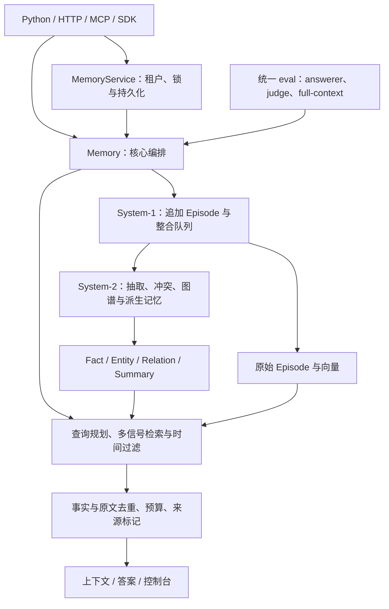

# 架构总览

MnemoTrace 将无损原始会话、双时间事实、关系图谱和派生记忆组合起来，为查询生成带来源的证据。System-1 与 System-2 表示职责分工，不要求两个操作系统进程。

## 阅读与代码导航

| 主题 | 说明 | 主要代码 |
| --- | --- | --- |
| 类型与生命周期 | [记忆、整合与存储](memory.md) | [types.py](../../mnemotrace/types.py)、[memory.py](../../mnemotrace/memory.py)、[consolidate](../../mnemotrace/consolidate/)、[store](../../mnemotrace/store/) |
| 查询与回答证据 | [检索与上下文](retrieval.md) | [retrieve](../../mnemotrace/retrieve/)、`Memory` 的读取方法 |
| 接入与隔离 | [服务架构](service.md) | [service.py](../../mnemotrace/service.py)、[server](../../mnemotrace/server/)、[connectors](../../mnemotrace/connectors/) |
| 页面与查询状态 | [控制台架构](console.md) | [frontend/src](../../frontend/src/) |
| 配置与外部依赖 | [配置参考](../reference/configuration.md) | [Config](../../mnemotrace/config.py)、`embed/llm/store` 接口 |
| 验证 | [评测操作](../../eval/README.md) | [eval](../../eval/)、[tests](../../tests/) |

设计理由见[取舍记录](../decisions.md)，缺陷和待验证状态仅由[问题台账](../issues.md)维护。当前架构图不构成性能或质量验收。

## 后端实现状态

| 层 | 默认离线实现 | 已实现的可选后端 | 规划中 |
| --- | --- | --- | --- |
| 嵌入 | `HashingEmbedder` | sentence-transformers、LiteLLM embedding API | — |
| 抽取/模型 | 规则实现 | LiteLLM | — |
| 向量 | 内存 | LanceDB | Qdrant、pgvector |
| 图 | 内存 | — | Kuzu、Neo4j、FalkorDB |
| 文档 | 内存 | — | — |
| 词法 | 内存 BM25 | — | tantivy、bm25s |

`durable` 是 JSONL + manifest 快照机制，`DocStore`/`GraphStore` 运行时仍为内存对象。规划中的后端不代表已有适配器或安装配置。外部依赖通过 extras 延迟加载，默认闭环只使用标准库。

## 目标与战略方向

长期目标是验证精确检索能否同时改善准确率与成本，并以开放框架和原始日志支持复现。

| 标识 | 方向 | 验证重点 |
| --- | --- | --- |
| Bet A | 超越 full-context 准确率并降低成本 | 同 rig 准确率、token 与延迟 |
| Bet B | 多跳查询规划 | 分解、图遍历、跨会话证据 |
| Bet C | 双时间与低成本冲突处理 | 知识更新、历史和来源链 |
| Bet D | 可复现评测框架 | 统一流水线、强 judge、原始日志 |
| Bet E | 分层分页、衰减与规模扩展 | 10M+ tokens 下的能力目标 |
| Bet F | 异步及休眠期整合 | 图谱、去重和冲突移出关键路径 |

以下是设计目标，不是当前成绩：System-1 热写入 <50ms，读取 <100ms，System-2 秒级异步整合。

| 里程碑 | 验收目标 |
| --- | --- |
| M0 | 零依赖 `add` → `consolidate` → `search`、双时间、冲突失效、as-of 与微型评测 |
| M1 | 真实后端与相同题目的 full-context 对照，`LongMemEval_S` 全集目标 >85% |
| M2 | 多跳与时间推理，`LongMemEval_S` 目标 90+，准确率超越 full-context |
| M3 | `LongMemEval_M`、`BEAM-1M/10M` 上验证 1M+ tokens 扩展 |
| M4 | 开放框架与日志，经 MCP、SDK 和更多基准扩大复现 |

成绩和限制见 [RESULTS](../../RESULTS.md)。候选优化应先解决已记录的问题，并按证据形态验证原文融合、演化链、多跳及时间区间推理，不能将候选表述为已取得收益。
