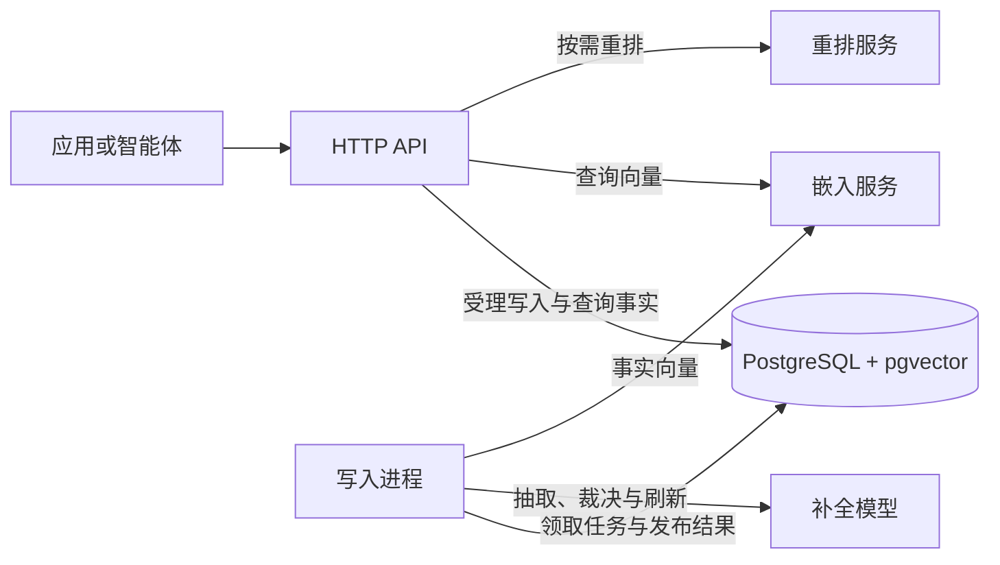

# 记忆引擎架构

本文面向引擎维护者和需要理解数据行为的接入方，介绍记忆模型、写入与召回流程，以及事实变更、派生数据和会话擦除的一致性边界。 [HTTP API v1 接入指南](../reference/http-api.md) · [自托管部署与运维](../../deploy/README.md)

## 目标与系统边界

MnemoTrace 将会话原文转化为可跨会话检索的事实。设计目标是保留事实的演变和来源、在并发与失败下维持写入一致性，并通过候选范围与证据预算控制每次召回的开销。模型承担抽取和语义判断，后端负责授权、时间区间、证据约束与事务提交。

HTTP 边界从 Bearer 凭据识别账号。会话、原文、事实、向量和后台任务按空间隔离。存储层验证账号与空间的归属，给读取流程提供一致快照，并在写事务中锁定对应的空间记录。应用层通过存储和推理端口访问 PostgreSQL 与模型服务。 [鉴权实现](../../mnemotrace/server/auth.py) · [存储边界](../../mnemotrace/adapters/postgres/storage.py)

## 数据模型

| 对象               | 作用与边界                                                                                 |
| -------------------- | -------------------------------------------------------------------------------------------- |
| 空间与会话         | 空间是跨会话事实、策略和查询的范围。会话组织一段对话的原文，消息按追加位置读取。           |
| 原文消息           | 保存角色、正文、发言时间和记录时间。写入过程为候选事实建立原文引用。                       |
| 事实               | 保存主体、谓词和对象，附带正文、有效期、来源类别、标签与敏感标记。对象可以是实体或字面值。 |
| 证据组             | 一组共同支撑同一个抽取事实的原文。一个事实可以有多组各自完整的证据。                       |
| 事实变更与截止归因 | 记录发布时的有效期变化，以及触发首次截止或提前截止的事实和相应证据。                       |
| 派生数据           | 用户画像引用事实，会话摘要覆盖同一会话的原文。各自由独立的后台任务更新。                   |

抽取事实必须关联原文。数据库保存证据组成员关系，召回与事实接口中的 `source_message_ids` 是去重后的来源列表。组的边界用于判断部分来源被擦除后，事实是否还有完整支持。 [领域事实](../../mnemotrace/domain/fact.py) · [证据组定义](../../mnemotrace/ports/storage.py) · [数据库模型](../../mnemotrace/adapters/postgres/migrations/001_initial.sql)

## 写入运行视图

1. **持久受理。** HTTP API 校验账号和空间。`remember` 用空间内的幂等键识别一次逻辑写入，同一键和相同会话、消息批次返回原任务。受理新任务前，服务检查会话和写入所需的模型配置。`202 Accepted` 表示写入任务已保存。
2. **后台处理。** 同一会话按受理顺序执行，不同会话可以并行。写入进程领取带租约的任务，在空间写锁之外进行抽取、嵌入和事实裁决。抽取预留本批原文的模型上下文，再按预算加入近期原文和可用摘要。
3. **复核并提交。** 写入进程在同一读快照取得事实版本和候选，在短写事务内复核版本、擦除代际和会话。事实版本变化时，释放锁后重查一次并复用已有裁决，只补判需要模型判断的新配对或变化的配对。第二次发布检查时版本仍有变化，当前执行结束，队列按退避策略重试。发布事务在验证任务租约后，一并提交原文、事实及其变更记录和任务成功状态。成功任务也可以只保存原文，此时事实变更数为 `0`。
4. **故障恢复。** 任务租约限制谁可以发布结果。可重试故障由队列重新调度，终态失败保存公开错误分类。客户端取得任务 ID 后可以继续查询同一任务，提交结果不明时可以重放原请求与幂等键。客户端协议见 [HTTP 幂等重试与恢复](../reference/http-api.md#幂等重试与恢复)。

把外部模型调用放在写锁外，可避免模型等待占用空间写锁。发布前复核让并发写入与擦除后的最新状态参与最终提交决策。 [写入实现](../../mnemotrace/application/remember.py) · [持久任务与租约](../../mnemotrace/adapters/postgres/operations.py)

## 事实生命周期

### 双时间轴

| 时间轴       | 字段          | 含义                                                   |
| -------------- | --------------- | -------------------------------------------------------- |
| 业务有效时间 | `valid_at`    | 有效起点，包含该时点。未知时为空。                     |
| 业务有效时间 | `invalid_at`  | 有效截止，从该时点起不再有效。尚无已知截止时为空。     |
| 系统记录时间 | `recorded_at` | 服务受理该事实所对应写入的时间。                       |
| 系统记录时间 | `expired_at`  | 服务首次记录有效截止的时间。后续缩短有效期时保留此值。 |

`as_of` 在当前已提交的数据上按业务有效时间筛选。补录的变更可以影响以后对同一历史时点的查询结果。每次发布事实变更时，审计用 `changed_at` 记录本次变更时间。 [事实时间规则](../../mnemotrace/domain/fact.py) · [发布实现](../../mnemotrace/application/remember.py) · [审计契约](../../mnemotrace/server/v1/audit_schemas.py)

### 模型裁决与后端落库

后端以主体、谓词和区间重叠选择结构候选，并用词法与向量检索补充候选。模型对事实对判断重复、可并存、冲突或不确定。后端依据裁决、有效区间和证据覆盖来确定写入结果。

- **重复。** 在证据满足代表事实的有效区间时，将它作为证据组加入代表事实。相同成员的证据组去重，敏感标记在合并时可传播到代表事实。
- **可并存。** 适用范围不同或允许同时成立的断言可以分别保存。
- **冲突。** 后端依据已确认的时序和证据为旧事实设置截止，保留旧事实的 ID、历史区间和变更记录。迟到证据能够支持更早的截止时，更新 `invalid_at` 并记录新的截止归因。
- **不确定。** 对缺少足够时序或证据的争议候选，后端可以暂缓发布。原文随成功的写入任务保存。

截止归因记录触发事实、该次确定的截止时间，以及裁决采用的原文。这样可以从历史区间的变化追溯到具体依据。 [候选与裁决](../../mnemotrace/application/adjudication.py) · [事实更新规则](../../mnemotrace/application/fact_lifecycle.py)

### 时序示例

以下三条消息来自不同会话，时间采用同一时区。

| 请求受理时间    | 会话原文                                               | 写入提交后的事实与证据                                     |
| ----------------- | -------------------------------------------------------- | ------------------------------------------------------------ |
| 10 月 1 日       | “从今天起，我工作日都坐地铁上班。”                   | 坐地铁从 10 月 1 日开始有效。                               |
| 11 月 3 日 09:00 | “从 11 月 1 日起，我工作日改骑车上班了。”             | 骑车事实从 11 月 1 日生效，坐地铁的事实在同一时点截止。     |
| 11 月 5 日       | “确认一下，从 11 月 1 日起，我工作日一直是骑车上班。” | 裁决为重复且证据覆盖条件成立时，为骑车事实追加独立证据组。 |

假设第二次写入在 11 月 3 日 09:02 发布。骑车事实的 `recorded_at` 是 09:00，坐地铁事实的 `expired_at` 和这次截止审计的 `changed_at` 记录为 09:02。业务上的切换时间仍是 11 月 1 日。发布后，以通勤方式为查询内容，`as_of` 取 10 月 31 日可召回坐地铁，取 11 月 1 日的生效时点可召回骑车。

## 召回运行视图

1. **构造可见范围。** 在授权空间内按有效时点、来源、标签与敏感标记过滤事实。多个标签按交集非空匹配，HTTP 召回默认排除敏感事实。
2. **生成候选。** 词法检索使用 PostgreSQL 全文检索，向量检索使用 pgvector。启用图召回时，可从指定实体或已有候选关联的实体沿出边扩展。跳数和边数受限，图候选遵循同样的时点与可见性条件。
3. **融合与排序。** 倒数排名融合（RRF）组合各路候选排名。可选重排器对受限的候选集重新评估相关性。对未指定 `as_of` 的当前查询，可通过 `prefer_recent` 给近期生效的事实有限加分，也可通过空间 `memory_decay` 让随时间衰减的显著度参与排序。
4. **裁剪与访问强化。** `top_k` 限制返回条数，`max_evidence_chars` 按证据正文字符数保留能装入预算的完整排序前缀。启用显著度衰减并允许 `track_usage` 时，未降级的当前查询可由后台记录此次实际返回的证据，后续查询使用更新后的显著度。

嵌入超时时保留词法检索和可用的图候选，并跳过重排。重排超时时继续使用融合所得的相关性分数。成功响应分别用 `degraded_reason`、`rerank_applied` 和 `truncated` 表明降级、重排执行和字符预算裁剪情况。 [召回实现](../../mnemotrace/application/recall.py) · [多跳图检索](../../mnemotrace/application/graph_recall.py)

## 后台派生数据

| 派生数据     | 输入与用途                                                                                       | 刷新与可见性                                                                                                                                               |
| -------------- | -------------------------------------------------------------------------------------------------- | ------------------------------------------------------------------------------------------------------------------------------------------------------------ |
| 用户画像     | 由空间用户已提交、当前有效、非敏感的抽取事实生成。画像条目引用支撑该条内容的事实。               | 支持手动刷新。开启 `profile_auto_refresh` 后，合格事实的变更会调度后台刷新。读取画像时复核来源事实的有效性和敏感性，使失去有效证据的条目及时退出可见结果。 |
| 滚动会话摘要 | 由上版摘要和当前会话中已提交的待摘要原文生成。后续事实抽取可以读取摘要与近期原文，控制输入规模。 | 开启 `session_summary_enabled` 后，追加原文会为超出近期窗口的消息安排刷新。后台按追加位置推进覆盖进度。发布前复核租约与擦除代际。                          |

画像与滚动摘要的自动机制按空间开启，默认关闭。它们的发布和主写入分别提交，刷新进度可落后于已提交原文和事实。 [画像生成](../../mnemotrace/application/profile.py) · [画像刷新](../../mnemotrace/application/profile_refresh.py) · [摘要生成](../../mnemotrace/application/session_summary.py) · [摘要刷新](../../mnemotrace/application/session_summary_refresh.py)

事实写入登记受影响的画像分组，同一事实可以为多组提供证据。自动刷新合并事实变化及有效期边界。删除或改写事实时，若即将移除尚未处理的到期边界，写入事务会登记该事实涉及的分组。

调度模块在同一事务内维护各组的时间边界和空间的最早到期时间。部分索引只收录开启自动刷新且存在边界的空间。Worker 按索引顺序领取到期空间，跳过持有写锁的空间，锁内推进该空间的到期边界并为实际发生的证据变化入队。关闭自动刷新时保留最早到期时间，重新启用后仍可处理错过的边界。 [PostgreSQL 部分索引](https://www.postgresql.org/docs/18/indexes-partial.html) · [PostgreSQL 行锁](https://www.postgresql.org/docs/18/sql-select.html#SQL-FOR-UPDATE-SHARE)

证据查询按空间、主体、分组和有效区间查找，按条数截取命中结果后再排序。有效区间包含起点，终点时刻起失效，缺少端点时向该方向开放。读取画像时，在同一读快照中用这些规则及当前分组复核条目的全部引用。更新事实标签、追加来源或登记未来截止时保留上一版。事实被物理删除或转为敏感时，写入事务清理依赖它的已存储条目。 [PostgreSQL 范围索引](https://www.postgresql.org/docs/18/rangetypes.html#RANGETYPES-INDEXING)

手动刷新重算四组，自动刷新重算待发布的组。后台在同一读快照内为每个待刷新组读取最多 128 条有效证据，另读一条探测超限。共享证据去重后合成一份模型请求，按完整请求检查上下文预算。模型结果通过校验后，后台在空间写锁下复核租约、组版本、有效期边界及擦除代际，然后用一个事务提交画像、已发布版本和任务状态。证据超限或生成失败时，读取端继续提供上一版中证据仍有效的条目。 [画像 API](../reference/http-api.md#用户画像) · [PostgreSQL 事务与隔离](https://www.postgresql.org/docs/18/transaction-iso.html)

## 擦除与一致性边界

会话擦除会删除会话原文及关联任务和摘要。证据组里有任一原文被擦除时，整个证据组退出支持该事实的证据集合。仍有完整证据组的事实继续保留，失去全部支持的抽取事实撤下。引用被擦除原文的事实变更记录也会清理，依赖已失效事实的画像条目退出可见结果。

以上述时序为例，擦除 11 月 5 日的确认会话后，11 月 3 日的消息仍可独立支撑骑车事实。保留事实的有效期沿用已提交的变更。空间的擦除代际用于阻止旧快照上的写入、派生结果或访问强化重新写回已擦除的数据。 [数据生命周期指南](../guides/data-lifecycle.md) · [会话擦除实现](../../mnemotrace/adapters/postgres/session.py) · [独立证据与审计测试](../../tests/postgres/test_erasure.py)

## 验证依据

| 架构行为                         | 仓库验证入口                                                                                                                                                                             |
| ---------------------------------- | ------------------------------------------------------------------------------------------------------------------------------------------------------------------------------------------ |
| 写入幂等、租约、并发与原子发布   | [写入任务回归](../../tests/postgres/test_operations.py)                                                                                                                                  |
| 有效期边界、重复合并与迟到证据   | [事实模型](../../tests/domain/test_fact.py) · [事实生命周期回归](../../tests/inference/test_fact_lifecycle.py) · [跨会话闭环](../../tests/postgres/test_memory_closure.py)             |
| 混合召回、预算、超时降级与图扩展 | [召回回归](../../tests/application/test_recall.py) · [图召回回归](../../tests/application/test_graph_recall.py)                                                                         |
| 后台刷新、过期证据与擦除         | [画像刷新回归](../../tests/postgres/test_profile_refresh.py) · [会话摘要回归](../../tests/postgres/test_session_summary_refresh.py) · [擦除回归](../../tests/postgres/test_erasure.py) |

验证命令和测试实例要求见[开发验证](../../README.zh-CN.md#开发验证)。召回质量、上下文成本与延迟的公开评测口径见[评测指南](../../eval/README.md)。
