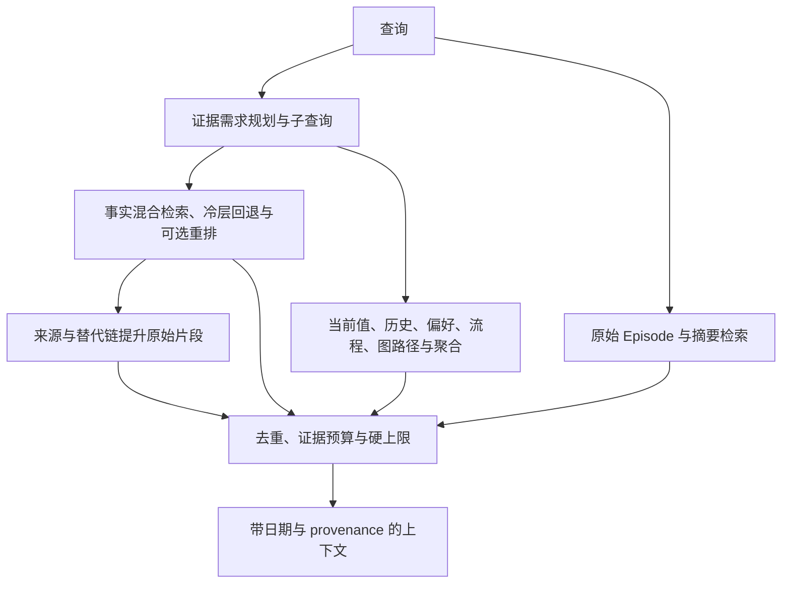

# 检索与上下文装配

读取组合已整合事实和检索到的原始会话片段。事实提供冲突与时间信号，原文补回抽取丢失的细节；摘要只作有来源的补充。

## 入口与数据流

| 入口 | 输出与用途 |
| --- | --- |
| `Memory.search` | `SearchResult`，面向直接事实查询及确定性答案 |
| `Memory.lean_context` | 上下文字符串，供服务 answerer 与 benchmark 主路径使用 |
| `Memory.context_for` | 另一上下文组装入口，不与 `lean_context` 混同 |
| `Memory.as_of` | `search` 的单个时间条件包装 |

服务 `recall` 根据参数调用相应入口。主要编排见 [memory.py](../../mnemotrace/memory.py)，规划与融合见 [retrieve](../../mnemotrace/retrieve/)。

## 证据规划

[plan_evidence](../../mnemotrace/retrieve/evidence.py) 根据 lookup、current-state、temporal、aggregation、preference、multi-hop 等证据形态生成需求，不读取 benchmark 类别标签。LLM 查询分解只有配置与模型允许时增加调用，离线模式保留确定性规划。

主问题和子查询共同选取证据池；主问题保留主要份额，防止弱子查询挤掉其来源。当前态、历史值、流程和聚合等块按实际问题与开关生成，不是每次查询都执行全部分支。

## 混合检索

[HybridRetriever](../../mnemotrace/retrieve/hybrid.py) 分别计算语义、BM25、图邻近、时近性与显著度的排名，然后做[加权 RRF](../../mnemotrace/retrieve/fusion.py)。不同量纲的原始分数不直接相加。

候选先经过用户、时间、单值槽头及图约束过滤。语义、词法和图谱提供正向相关性；时近性和 `salience` 只作先验，不能让无证据项获得伪相关性。类型倍率只作用于真实 embedder 的语义信号，哈希回退不享有相同语义能力。

默认检索 `live` facts；需要历史证据的路径另展开替代链。热层不足时回查冷层。ANN 候选生成与交叉编码器重排是可选路径，默认状态及参数以 [Config](../../mnemotrace/config.py) 和调用参数为准。

图邻近按跳数衰减，可结合关系与查询的对齐、多路径强化、self/别名锚定和负约束。代理 `recall` 提升不保证最终 QA 改善，图权重调整必须包含真实多会话验收。

## 原始证据与预算

| 证据来源 | 作用 |
| --- | --- |
| `retrieve_episodes` | 按查询检索原始细节 |
| `fact.provenance` | 命中事实后回到源会话 |
| `supersedes` 链来源 | 历史值问题补回旧事实对应原文 |
| `retrieve_summaries` | 来源摘要与 fact-miss 回退 |
| 聚合候选 | 从事实、原文和摘要提取数值及局部约束 |

原文提升最多占部分 chunk 预算，余量回流，避免错误事实挤掉全部查询原文。已提升为 detail 的会话不重复放摘要。证据类型优先级和硬上限由 budgeting 处理；实际 `n_facts`、`n_summaries`、`n_chunks`、`char_budget` 仍是调用参数，不能当作全局 `Config` 默认值。

当前偏好块使用“当前偏好记录（结构化）：”标题；旧英文偏好标题在预算中归 other，不改写原始内容。原始片段标注“原始记录时间 / 会话 / 记录内容”，时间优先取来源 `metadata.date`，再取 `Episode.event_time`，不能用查询时间替代。

answerer 使用组装后的原始上下文，界面折叠不会减少模型输入。服务回答提示要求核对人物关系，并以对应记录时间理解相对表达；没有独立相对时间解析器或新增时间字段。

## 多跳、历史与聚合

[MultiHopPlanner](../../mnemotrace/retrieve/planner.py) 从当前用户的实体及谓词寻找锚点，按关系顺序遍历并应用 as-of 和实体约束。地点链、项目链等确定性路径可直接返回答案和支撑事实，图路径也可作为 `lean_context` 的证据。

当前值块使用 `live` 槽头，历史/演化块沿 `supersedes` 追踪更新。`as_of` 沿 `Fact.is_live` 和图邻居过滤；当前 API 不提供独立 T / K 查询。时间跨度算术及复杂多桥接推理仍需按具体问题验证。

[aggregate.py](../../mnemotrace/retrieve/aggregate.py) 对 `count`/`sum/money/hour/page` 等问题组织 `AggregationCandidate`，扩展召回并依据月份等题面局部约束标记排除项。候选表交给 answerer，不代表所有数值均已正确聚合。

## 直接搜索与弃答

`search` 先尝试多跳、历史和流程路径，再做混合检索、冷层与摘要回退，最后经过弃答门控。`lean_context` 则组织多种证据供下游回答，两者不保证逐字一致。无属性依据或相似度不足时应拒答，不能仅靠实体名命中猜答案。

配置含义见[配置参考](../reference/configuration.md)，已采纳与回滚证据见[设计取舍](../decisions.md)和[实验索引](../../results/experiments/README.md)。证据过宽、重复及提示词质量验证的状态见[问题台账](../issues.md)。
