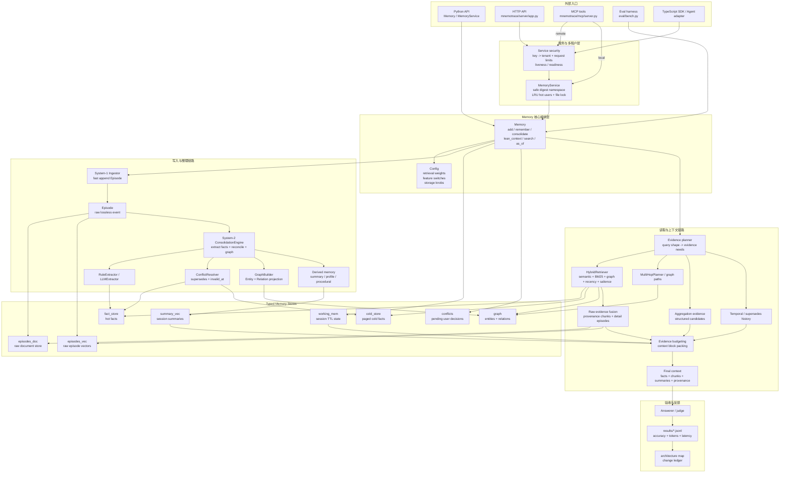
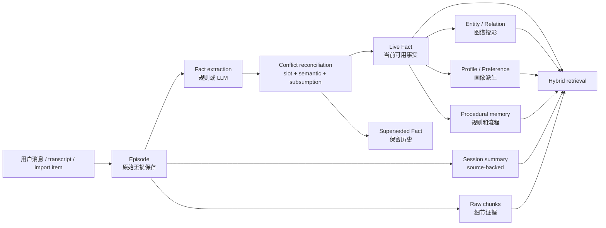
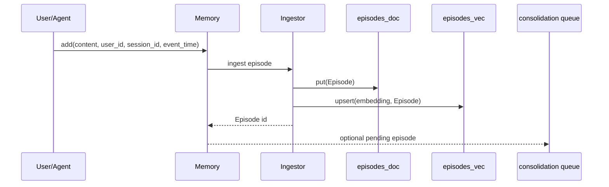
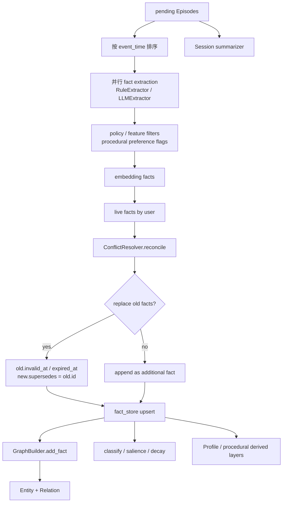
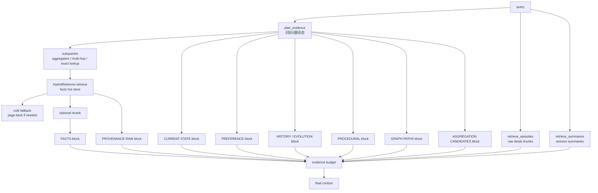
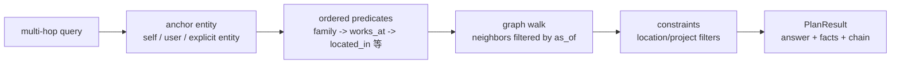
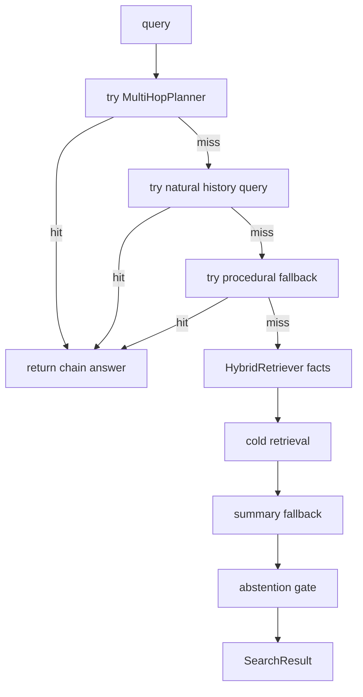
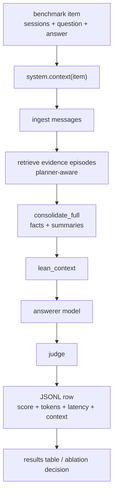

# 忆痕全链路架构与数据流报告

本文按模块描述 MnemoTrace 的当前实现：消息如何写入、整理和持久化，查询如何得到证据与答案，
以及 HTTP、MCP、SDK 和管理控制台如何共享记忆服务。产品中文名为忆痕，英文名为 MnemoTrace；
Python import 为 `mnemotrace`，Python/npm 发行包为 `mnemotrace-memory`。

报告中的架构目标不等同于全部功能已通过验收。未解决风险与功能缺口统一见
[问题与改进跟踪](known-issues.zh-CN.md)，改动原因和实验取舍见
[架构优化地图](architecture-optimization-map.zh-CN.md)。公开成绩只以
[RESULTS.md](../RESULTS.md) 及已提交的原始日志为准。

## 0. 阅读入口

| 你想看什么 | 入口 |
| --- | --- |
| 整体结构、对象与数据流 | 本文第 1～8 节 |
| 配置、服务与控制台 | 本文第 9～10 节 |
| 评测、实现边界与代码定位 | 本文第 11～16 节 |
| 文档维护规则 | 本文第 17 节 |
| 改动原因、算法取舍和实验索引 | [架构优化地图](architecture-optimization-map.zh-CN.md) |
| 算法原则 | [算法架构](algorithm-architecture.md) |
| 尚未解决的问题 | [问题台账](known-issues.zh-CN.md) |
| 评测证据与规则 | [results 说明](../results/README.md)、[公开结果](../RESULTS.md) |
| 自托管交付范围 | [交付说明](commercial-release-0.1.0.zh-CN.md) |
| 项目使命与贡献约束 | [AGENTS.md](../AGENTS.md)、[CONTRIBUTING.md](../CONTRIBUTING.md) |

建议先读第 1～5 节建立对象与写入流程，再读第 6～10 节理解持久化、检索和产品入口。
修改算法前核对配置开关、验收分层与问题台账，区分已实现行为、已验证结果和候选方向。

## 1. 当前架构一句话

MnemoTrace 是一个双过程长期记忆引擎，将原始记录、双时间轴事实、关系图谱和派生记忆组合起来：

```text
lossless Episode 原始会话
  + bi-temporal Fact 原子事实
  + Entity/Relation 图谱
  + source-backed Summary 原始来源摘要
  + Procedural / Preference / Profile 派生记忆
  + WorkingMemory 会话态短期记忆
  + Evidence planner 问题形态规划
  + Hybrid retrieval 多信号融合
  + Raw evidence fusion 细节补回
  + Reproducible eval harness 真实数据验收
```

架构目标是以更少、更准、带 provenance 的证据切片提升问答质量，并与 full-context 同时比较准确率、token 和延迟。

## 2. 全局分层图



## 3. 核心数据对象

MnemoTrace 的数据模型在 `mnemotrace/types.py`。理解这些对象，就能理解所有数据流。

| 对象 | 产生位置 | 保存位置 | 被谁消费 | 关键字段/不变量 |
| --- | --- | --- | --- | --- |
| `Episode` | `Memory.add`, `Memory.remember`, import | `episodes_doc`, `episodes_vec`, persistence `episodes.jsonl` | consolidation、raw retrieval、summary、eval | 原始无损事件；`event_time` 是世界时间，`ingested_at` 是事务时间；不因抽取失败丢弃 |
| `Fact` | `RuleExtractor`, `LLMExtractor`, `add_fact` | `fact_store`, `cold_store`, persistence `facts.jsonl` | hybrid retrieval、graph、profile、history、context blocks | 原子`(subject, predicate, object)`；双时间轴；contradiction 只失效不覆盖；保留 provenance |
| `Entity` | `GraphBuilder.add_fact` | `graph`, persistence `entities.jsonl` | graph retrieval、multi-hop、graph API | 以`user_id + canonical name` 定位；可带 aliases |
| `Relation` | `GraphBuilder.add_fact` | `graph`, persistence `relations.jsonl` | graph proximity、multi-hop、graph visualization | 由 Fact 投影；携带`fact_id` 和双时间过滤能力 |
| `WorkingMemory` | `remember_working`, ephemeral `remember` | `working_mem`, persistence `working.jsonl` | `lean_context`, agent status, session report | 会话/TTL 范围内生效，不自动变成长期 profile |
| `Conflict` | `_detect_conflicts`, manual conflict tools | `conflicts`, persistence `conflicts.jsonl` | conflict UI/API/MCP | 对高风险矛盾等待用户确认，不静默破坏记忆 |

### 3.1 双时间轴

每个事实有两组时间：

| 时间轴 | 字段 | 含义 | 用途 |
| --- | --- | --- | --- |
| valid time | `valid_at`, `invalid_at` | 事实在现实世界中什么时候为真 | `as_of`、历史问题、knowledge-update |
| transaction time | `created_at`, `expired_at` | 系统什么时候学到/撤回它 | 审计、回放、数据修复 |

规则：矛盾事实不要 hard-delete。旧事实设置 `invalid_at`/`expired_at`，新事实设置 `supersedes` 指向旧事实。

### 3.2 数据从 raw 到 typed 的生命周期



### 3.3 用户编辑、元数据与来源

事实编辑沿 `HTTP/MCP → MemoryService.update_fact → Memory.update_fact` 执行，以实际字段值
区分内容修改和元数据修改。`source` 表示正文是否为用户断言，`provenance` 表示关联的原始 Episode。

| 编辑类型 | 当前行为 |
| --- | --- |
| 只改 sensitive/category，或原样回传内容字段 | 只保存明确提交的元数据；保留 source、正文、display、向量、有效/事务时间、supersedes、provenance 和图边 |
| 实际修改 subject/predicate/object | 重建正文、向量和图边，重新分类并应用显式覆盖；source 设为 user，保留原 provenance；清除 invalid_at/expired_at 使该记录重新生效 |
| 会话结论整句编辑 | statement 仅接受 decision/finding/lesson/open_question；正文保留依据子句，object/display 使用修正后的陈述 |
| 属性事实提交 statement，或与三元组字段混用 | 修改前拒绝，HTTP 返回 422；不存在的事实返回 404 |

未变化的内容不因保存表单而重新生效。内容编辑是对既有记录的修正，不会自动创建一条新的历史版本，
也不能把“保留来源”解释为修正后的内容仍逐字来自原文。`display_of` 统一负责自然语言展示回退。
验证入口：[元数据与历史](../results/fact_metadata_history_validation.md)、
[事实来源](../results/fact_source_metadata_validation.md)、
[属性与整句编辑语义](../results/fact_statement_semantics_validation.md)。

## 4. 写入链路

写入链路分两层：System-1 快写路径和 System-2 睡眠期整理路径。

### 4.1 写入入口

| 入口 | 文件/函数 | 适用场景 |
| --- | --- | --- |
| Python 直接写入 | `mnemotrace/memory.py::Memory.add` | 低层 API，追加 Episode，可选立即 consolidate |
| 用户语义写入 | `mnemotrace/memory.py::Memory.remember` | 自动判断长期/短期 scope，始终保留 raw Episode |
| 批量导入 | `Memory.import_messages`, `Memory.import_data` | ChatGPT export、OpenAI messages、JSONL、transcript |
| 服务层写入 | `mnemotrace/service.py::MemoryService.remember` | 多用户、多租户、持久化、锁 |
| HTTP 写入 | `mnemotrace/server/app.py::remember`, `import_history` | API 服务 |
| MCP 写入 | `mnemotrace/mcp/server.py` | 给外部 Agent 持久记忆工具 |

### 4.2 System-1 快写路径

目标：在热写路径上不依赖 LLM，不做重计算，先把原始证据可靠保存。



关键点：

| 设计点 | 当前实现 | 原因 |
| --- | --- | --- |
| 原始消息先保存 | `Episode` 写入 `episodes_doc` 和 `episodes_vec` | 抽取错了也能从 raw evidence 补回 |
| 写路径默认无 LLM | hashing embedder + rule extractor 可零 key 运行 | 保证 zero-setup 和稳定测试 |
| event/transaction 分离 | `event_time` 与 `ingested_at` 同时保存 | 支持真实历史时间和系统学习时间 |
| 可选立即整理 | `add(..., consolidate=True)` | 小 demo 可同步完成，大规模可异步 |

### 4.3 `remember` 的长期/短期分流

`Memory.remember` 总是保存 Episode，但会根据 scope 和文本判断是否写入 WorkingMemory：

| 路径 | 条件 | 结果 |
| --- | --- | --- |
| 长期记忆 | `scope="long"` 或 auto 判断为长期内容 | Episode 等待 consolidation，后续产生 Fact/Summary/Graph |
| 短期/会话态 | `scope="working"` 或 auto 命中临时表达 | 写入`WorkingMemory`，仍保留 Episode metadata |
| 显式 working | `remember_working` | 直接写会话态记忆，可设置 TTL |

这样做避免“临时状态污染长期画像”，同时保留审计来源。

### 4.4 批量导入与会话喂入

`connectors` 解析 ChatGPT、OpenAI messages、JSONL、transcript 和 agent-session 等输入，
`Memory.import_messages` 按会话建立 Episode，批量嵌入并按内容指纹去重。无原始日期的输入可以使用
显式合成时钟；有日期的输入保留其来源时间。

本地批量导入 CLI（`python -m mnemotrace.connectors` / `mnemotrace-import`）通过
`MemoryService.import_()` 写入，与 HTTP/MCP 共用摘要目录、内容指纹和完整服务写锁。
不再自行清洗 namespace 拼接账号名目录，也不回退 `.pkl`。CLI 默认显式选择 hashing/规则抽取，
实际嵌入/LLM 仍由命令行参数选择；原有“不整理/不摘要”参数传递给共享导入流程，结束或失败后关闭服务实例。
验证见[本地 CLI 验收](../results/import_cli_digest_validation.md)。

普通来源的 `consolidate=None` 按长期事实整理。`metadata.source="agent_session"` 的转录默认
存储原文与摘要，并标记 `consolidated=True`、`metadata.extraction="outcomes_only"`；只有显式
`consolidate=True` 且服务端挂载 LLM 时才逐轮抽取，避免将工作对话当成传记三元组。
响应中的 `facts_deferred`、`deferred_reason` 说明未进行逐轮抽取的原因。

watcher 按 tick 发现转录、导入并关闭会话；状态台账位于 `~/.mnemotrace/watch_state.json`，
文件锁避免重叠运行，安装器支持 launchd/systemd 用户任务，cron 路径提供配置行。
SessionEnd hook 与 watcher 通过目标指纹、seen/claim 台账协调喂入；平台支持和安装方式见
[接入说明](agent-adapters.md)与[跨 agent 记忆](cross-agent-memory.md)。

watch 与 hook 的安装预检直接启动指定解释器，通过 subprocess 的 env 参数提供最小环境，
不依赖外部 POSIX `env` 命令。Windows 额外保留系统目录变量并设置目标 USERPROFILE；
不继承调用方的 PYTHONPATH、PYTHONHOME、venv 激活或供应商凭据。子进程导入前离开仓库目录，
避免当前检出的源码掩盖未安装模块；解释器启动失败或模块不可导入时返回预检诊断，实际安装在写入前拒绝。
实现与验证边界见[安装预检验收](../results/watch_preflight_validation.md)。

## 5. System-2 整理链路

System-2 由 `mnemotrace/consolidate/engine.py::ConsolidationEngine` 编排。



### 5.1 抽取层

| 模块 | 文件 | 作用 |
| --- | --- | --- |
| 规则抽取 | `mnemotrace/consolidate/extractor.py::RuleExtractor` | zero-key 默认抽取 names、location、preference、procedure、project rule 等 |
| LLM 抽取 | `mnemotrace/consolidate/llm_extractor.py::LLMExtractor` | 可选增强，不作为 zero-setup 必需项 |
| 分类 | `mnemotrace/consolidate/classify.py` | 给 fact 标 category/sensitive，用于 redaction 和 profile |
| 结构化画像 | `mnemotrace/consolidate/structured.py` | 把 live facts 组织为 profile |
| 会话结论蒸馏 | `mnemotrace/consolidate/outcomes.py::extract_outcomes` | 在 close_session 中分析整段会话，产出 decision/finding/lesson/open_question 四类 Fact |

会话结论补充逐轮属性抽取：subject 为 session ID，object 为完整陈述，text 包含陈述与依据子句。
该蒸馏分支在满足调用条件时使用一次 LLM；结论仍经 classify 计算敏感位，category 固定为“会话结论”，
供检索、Journal 和按敏感范围过滤的视图共用。重复调用的去重边界见第 10.4 节。

抽取能力包括显式偏好、偏好对象过滤/规范化、偏好反转、过程记忆、数值聚合候选等。实现取舍与证据见[架构优化地图](architecture-optimization-map.zh-CN.md)的“已落地优化台账”。

### 5.2 冲突处理层

`mnemotrace/consolidate/conflict.py::ConflictResolver` 的原则是便宜判断优先，LLM 只处理模糊情况。

| 判断 | 例子 | 处理 |
| --- | --- | --- |
| exact slot | 同一`subject + predicate` 出现新 object | 单值 predicate 下旧事实失效 |
| preference reversal | 先喜欢 X，后来不再喜欢 X | 新 fact supersedes 旧 preference |
| content subsumption | 新事实包含旧事实更多细节 | 可能作为 elaboration 或 replacement |
| embedding similarity | predicate 文本不同但语义同槽 | 仅在有真实 embedder 时使用 |
| protected/multi-valued guard | 家人、同事、多个项目等可多值 | 不误删可并存事实 |
| ambiguous LLM adjudication | 规则无法确定 | 可选 LLM 判断 |

冲突后的数据不变量：

```text
old.invalid_at = new.valid_at
old.expired_at = now
new.supersedes = old.id
old.provenance 保留
new.provenance 保留
graph relation for old fact 被 invalidate
```

### 5.3 图谱投影层

`mnemotrace/consolidate/graph_builder.py::GraphBuilder` 把适合图谱表达的事实投影成 Entity/Relation。

| 输入 fact | 图谱动作 |
| --- | --- |
| `self lives_in Beijing` | upsert entity`self` 和 `Beijing`，增加 `lives_in` relation |
| `sister works_at Acme` | upsert`sister` 和 `Acme`，增加 `works_at` relation |
| `procedure/how_to/routine` | 默认不投影为对象节点，留在 procedural memory |
| `decision/finding/lesson/open_question` | 同上，不投影。结论的宾语是整句话、主语是 session id，建边会把整句话 upsert 成实体、每个 session 造一个孤立节点，并在体检里伪造出`orphan_entity` |

图谱主要支持：

1. multi-hop planner，例如“我同事的公司在哪里”。
2. graph proximity scoring，让与 query 实体邻近的 fact 加分。
3. graph API/UI，让用户看到实体关系。
4. relation invalidation，让旧事实失效时图谱边也随之失效。

### 5.4 摘要、画像与策略语言

`EXTRACT_SYSTEM`、`SESSION_SUMMARY_SYSTEM`、`PERSONA_SYSTEM` 由 POLICY_DEFAULTS 暴露，
`_effective()` 优先读取用户 policy 覆盖项。保存策略会清除画像缓存，并应用到后续整理；
默认值变化不会强制覆盖自定义策略，也不会批量改写已有事实或摘要。

- 事实使用英文 JSON 字段和英文 predicate；subject/object 的值及展示句跟随原文语言。
- 会话摘要跟随原对话的主要语言，保留专名、准确数值和原文细节；离线或调用失败时保留原文截断回退。
- 叙事画像使用简体中文，组织为“身份与背景、兴趣与偏好、限制与目标、回答与协助偏好”小节，缺少依据时省略。
- 结构化画像从事实派生，`evidence.source_count` 为 provenance 中不同 Episode ID 的数量；无来源为 0。
  `evidence.count` 在强化分支中仍表示访问次数，不能替代来源数量或语义置信度。

画像候选、分类和展示的已知限制见[问题台账](known-issues.zh-CN.md#issue-006)。
调用链验证见[提示词与上下文](../results/chinese_prompt_context_validation.md)、
[摘要语言](../results/summary_source_language_validation.md)及[画像来源](../results/profile_evidence_validation.md)。
这些验证不代替真实模型质量或完整 benchmark 评测。

## 6. 存储与持久化

MnemoTrace 的 core 接口在 `mnemotrace/store/base.py`，默认实现是内存 store，可选后端在 extras 中扩展。

| Store | 默认实现 | 保存什么 | 读路径用途 |
| --- | --- | --- | --- |
| `episodes_doc` | `InMemoryDocStore` | 原始 Episode | raw chunks、session report、provenance |
| `episodes_vec` | `InMemoryVectorStore` | Episode embedding | raw retrieval、detail chunks |
| `fact_store` | `InMemoryVectorStore` | hot live/superseded facts | hybrid retrieval 主体 |
| `cold_store` | `InMemoryVectorStore` | 被分页的 cold facts | 大规模时补召回 |
| `summary_vec` | `InMemoryVectorStore` | session summaries | summary fallback、context blocks |
| `graph` | `InMemoryGraphStore` | entities/relations | multi-hop、graph proximity |
| `working_mem` | dict/state | WorkingMemory | session context |
| `conflicts` | dict/state | Conflict | 用户确认 |

持久化在 `mnemotrace/store/persist.py`：

```text
manifest.json
episodes.jsonl
facts.jsonl
entities.jsonl
relations.jsonl
working.jsonl
conflicts.jsonl
```

持久化约束：

1. embedder id/dim 会写入 manifest，避免向量维度不兼容。
2. `Memory.save(path)` 只保存状态，不保存 LLM/embedder 对象本身。
3. `Memory.open(path, **kwargs)` 用当前传入的后端能力恢复 store。
4. `MemoryService` 按逻辑 namespace 选择存储路径，读改存由线程锁与进程文件锁串行化；路径所有权风险见第 6.3 节。
5. manifest 的可选 `snapshot_id` 标识一次提交。加载器和保存函数将实际读取/提交的令牌绑定至 Memory；旧格式按 manifest 原文 SHA-256 识别，无需预迁移，下一次正常保存写入新标识。`schema_version` 保持 1。
6. Windows 的 manifest 读取使用允许共享删除的句柄，已有 manifest 通过 ReplaceFileW 原子替换；首次创建及 POSIX 路径仍使用 os.replace。已有读者可继续读取旧 manifest，新读者看到新提交。

### 6.1 嵌入模型身份与维度

`LiteLLMEmbedder` 是远端 embedding API 的适配层。默认模型为 `openai/BAAI/bge-m3`，
`make_embedder("openai:")` 选择同一模型；`openai:` 是工厂前缀，`openai/` 是 LiteLLM 接口路由，
实际模型为 BAAI/bge-m3，声明维度固定为 1024，不允许其他维度。

其他 API 模型需显式提供正整数 dim，例如 `make_embedder("openai:<model>", dim=...)`。
仅通过服务环境中的模型名称配置、未提供维度时会报错。维度在首次请求前确定，不能根据响应修改；
每条 API 返回向量都必须符合声明维度。manifest 同时校验模型身份和维度，避免混用嵌入空间。

默认服务仍使用零依赖 hashing。远端凭据与地址由 OPENAI_API_KEY、OPENAI_BASE_URL 提供，
与 MnemoTrace 的 Bearer key 不同，配置见[API.md](../API.md)。存量库切换模型应先备份，
通过显式 reembed 迁移；服务的 `MNEMOTRACE_REEMBED_ON_MISMATCH=1` 才允许加载时重嵌入。
验证入口：[API 嵌入维度](../results/api_bge_dimension_validation.md)、
[BGE-M3 适配层](../results/api_bge_1024_refactor_validation.md)。

### 6.2 跨线程、跨进程锁

`MemoryService.write_lock(user)` 先取得规范化稳定锁路径对应的进程内共享可重入线程锁，再取得数据根目录下的
`@<安全命名空间>.service.lock`。该文件仅用于同步，路径不随新旧存储目录选择变化，
也不随 namespace 清空而删除。持久化保存另在目标存储的 `.lock` 上串行执行。
同一存储路径的多个服务实例共用 `_namespace_lock` 协调对象，文件锁所有权按线程保存，
只有最外层持有者打开、释放句柄；实例自身的热缓存继续相互独立。注册表锁与缓存元数据锁
`_g` 仅保护内存结构，不覆盖路径解析、manifest 读取或锁等待。

写作用域覆盖获取最新提交、加载、必要迁移、修改与保存，最外层写事务中的首次 get 必须在
获得文件锁后重新校验缓存版本。`_save` 要求对象属于当前写操作，并校验基准提交令牌；
同线程跨实例嵌套提交使旧对象过期时明确拒绝回写。失败或中断的保存/迁移不保留脏热缓存。

读作用域用线程锁保护整个检索、权重强化、冷热搬迁、工作记忆清扫及响应组装。默认内存索引
缓存命中且 manifest 令牌相同时不取文件锁；缓存缺失或版本变化时，持文件锁二次检查并加载
全部集合后发布缓存，避免混合代快照。嵌套 agent_status/stats/get 固定本次对象，LRU 淘汰不会
使操作中途更换对象；业务响应与可变缓存引用分离。跨空间召回逐空间完成，不同时持有多个用户锁。

默认内存索引的热读可返回操作开始时看到的上一份已提交缓存，不保证跨进程写入期间严格实时。
查询分解、planner 等读取中的 LLM 调用保留线程锁但不持文件锁；answerer 只使用已组装字符串，
在读取作用域退出后调用。同步 remember/consolidate 的 LLM 仍在写锁内。LanceDB 配置的读取
保守地保持文件锁，不能直接套用内存索引热读规则。裸 get 返回的可变对象不具备独立
并发事务能力，直接 Memory.open/save 的并发读改存与保存中途崩溃恢复另行处理。

`_flock` 统一封装 POSIX flock 与 Windows msvcrt：Windows 锁住字节 0，非阻塞加锁的 EACCES
表示竞争，阻塞获取时等待 10ms 重试；POSIX 非阻塞 EACCES/EAGAIN 返回 False。
两平台遇到 EINTR 重试，定位失败和其他真实错误向上传播。上下文关闭文件释放锁，hook/watch
在获取异常时也关闭句柄，不将所有文件故障误当成竞争。

共享数据目录的进程必须统一升级后重新启动，不能混跑不遵守该加载/提交协议的旧进程。
验证见[文件锁错误分类](../results/flock_error_handling_validation.md)、
[清空并发](../results/forget_concurrency_validation.md)与
[ISSUE-033/034 访问协议验收](../results/issue033_034_validation.md)。提交 `9bb7395` 已通过
Windows/Ubuntu、Python 3.10/3.12 四组 CI，以及 web/container 检查；
[CI 原始证据](../results/issue033_034_ci_validation.jsonl)对应
[运行记录](https://github.com/NotZhu/MnemoTrace/actions/runs/39378499937)，问题台账已标记为已修复。

### 6.3 命名空间目录、擦除与迁移边界

默认数据根目录为 `~/.mnemotrace/data`，容器使用 `/data`，systemd 使用 `/var/lib/mnemotrace`。
`_safe_user` 用可读前缀和原始 namespace 的 SHA-256 摘要生成目录名，`_contained_child`
检查真实路径是数据根目录的直接子项，且最终目录项名称与请求名称完全一致，拒绝同级链接以及
Windows 大小写/尾点别名。`_path` 始终返回自身摘要目录，读取、写入和 forget 均不回退至旧名字。
`_legacy_safe_user` / `_legacy_paths` 已移除。逻辑 ID 即使与另一租户的目录名相同，也只访问自己的
摘要目录；[ISSUE-002](known-issues.zh-CN.md#issue-002) 已完成合成隔离修复验收，线上部署未核验。
验证命令见[仅摘要目录验收](../results/digest_only_namespace_validation.md)，本地导入 CLI 的补齐见
[CLI 验收](../results/import_cli_digest_validation.md)。其他兼容收束项仅记录于
[问题台账 ISSUE-023～032](known-issues.zh-CN.md#issue-023)，当前未实施。

所有旧目录都不会被服务自动认领、读写、迁移、合并或擦除。管理员须停止共享目录的全部进程并备份，
结合历史配置和来源确认实际 namespace，再显式复制到其尚不存在的摘要目录；验证后再处置旧来源。
普通 JSONL 目录可通过 Memory.open(source).save(destination) 显式复制，并使用与原库一致的
embedder/config；真正的 pickle 文件仍只能走下面的可信旧快照迁移入口。既有摘要映射与存储格式不变。

`forget()` 在两层服务写锁内清除热缓存、校验唯一的摘要路径并删除该目录，完成后才释放锁。
`shutil.rmtree` 不遍历子目录符号链接或 Windows junction 的目标；扫描失败向上传播。
等待中的写入取得锁后重新读取路径，按需建立新存储。验证见
[擦除与目录边界](../results/maintenance_cleanup_validation.md)。

旧产品默认目录和 Compose 卷不会自动扫描、合并或搬运。普通 Memory.open 不读取 pickle；
可信旧快照只能通过显式迁移命令处理，历史类型路径的适配缺口见
[ISSUE-015](known-issues.zh-CN.md#issue-015)。命名与运行入口边界见
[入口验收](../results/mnemotrace_rename_validation.md)，不构成旧数据已迁移的保证。

## 7. 读取链路总览

读取有三个主要入口：

| 入口 | 函数 | 返回 | 用途 |
| --- | --- | --- | --- |
| 直接搜索 | `Memory.search` | `SearchResult` | 简单 API，能返回 top facts 和 answer |
| 上下文装配 | `Memory.lean_context` | context string | benchmark/headline 主路径，给 answerer 读 |
| 兼容上下文 | `Memory.context_for` | context string | 更老/更通用的 context builder |

服务层 `MemoryService.recall` 会根据参数调用 `lean_context` 或 `search`，HTTP 和 MCP 最终也走这些入口。

### 7.1 `lean_context` 证据装配

`lean_context` 的目标不是直接回答，而是给下游 answerer/judge 组装一份高信噪比证据包。



### 7.2 Evidence planner

`mnemotrace/retrieve/evidence.py::plan_evidence` 先判断问题需要哪类证据。

| 识别类型 | 典型问题 | 会触发的证据 |
| --- | --- | --- |
| exact lookup | “我妹妹住哪里” | facts + graph + raw |
| current state | “我现在的地址是什么” | slot head/current-state block |
| temporal/history | “我以前喜欢什么” | supersedes chain/history block |
| aggregation | “我总共花了多少钱” | subqueries + aggregation candidates + raw chunks |
| duration | “我练了多久” | duration block |
| preference | “我喜欢什么咖啡” | preference facts/profile |
| procedural | “我说过要怎么部署” | procedural memory |
| multi-hop | “我同事的公司在哪里” | planner subqueries + graph paths |
| abstention-sensitive | “有没有证据证明...” | 更谨慎的 abstention |

规划结果会影响：

1. 检索子查询数量。
2. `n_facts`、`n_summaries`、`n_chunks` 预算。
3. 是否启用 agentic/cascade/raw/detail/provenance。
4. evidence block 的优先级和裁剪方式。

### 7.3 Hybrid retrieval

`mnemotrace/retrieve/hybrid.py::HybridRetriever` 是 fact 检索核心。

```text
score(item | query)
  = semantic similarity
  + lexical/BM25 evidence
  + graph proximity
  + recency prior
  + salience prior
  + type weights
```

注意：recency 和 salience 是 prior，不应该伪装成证据。当前架构原则要求“没有 lexical/semantic/graph 命中的项不能只靠 prior 被推上来”。

| 信号 | 代码位置 | 作用 |
| --- | --- | --- |
| dense semantic | `fact_store.search`, embedder | 召回语义相近事实 |
| lexical/BM25 | `mnemotrace/retrieve/lexical.py` | 精确词、日期、名称匹配 |
| graph proximity | `_graph_scores` | 根据实体 n-hop 邻近度加权 |
| relation relevance | `graph_relation_relevance` | query 与 relation predicate 对齐 |
| self/entity alias anchor | `query_entity_ids` | 把 “my/me/I/别名” 锚到用户实体 |
| negative constraints | `graph_exclusion_zone` | 避免“不包括 X”的实体污染 |
| slot heads | `_current_slot_heads` | 单值属性优先当前事实 |
| weighted RRF | `mnemotrace/retrieve/fusion.py` | 融合多路排名 |

### 7.4 Raw evidence fusion

事实抽取会损失细节，问答证据需要组合结构化事实与检索到的原始会话 chunks。

Raw evidence 来源：

| 来源 | 函数 | 用途 |
| --- | --- | --- |
| query 直接检索 Episode | `retrieve_episodes` | 找原始细节 |
| fact provenance | `_provenance_detail_chunks` | 命中 fact 后回到源会话补细节 |
| chain provenance | `_chain_facts_for_seeds` -> `_provenance_detail_chunks` | previous-value / current-vs-past 问题中，把`supersedes` 链上的旧事实来源也纳入 raw chunk promotion |
| provenance raw block | `_provenance_raw_block` | 给 answerer 看事实来源上下文 |
| session summaries | `retrieve_summaries` | raw 太长时给 source-backed 摘要 |
| aggregation raw episodes | `_aggregation_block` | 数值/列表问题从源文本抽候选 |

当前原则：

1. Facts 给结构和 current-state。
2. Raw chunks 给细节和完整句子。
3. Summary 是补充，不替代 raw。
4. Provenance 让 answerer 能看到证据来自哪段会话。

### 7.5 Multi-hop 与图路径

`mnemotrace/retrieve/planner.py::MultiHopPlanner` 先做确定性链路推理：



`lean_context` 还会通过 `_graph_paths_block` 把相关 graph path 放进 context，帮助 answerer 处理多跳问题。

多会话与多 bridge entity 的进一步优化方向见第 14 节。

### 7.6 Temporal / history / as-of

时间链路由三部分组成：

| 能力 | 函数 | 数据来源 |
| --- | --- | --- |
| 当前值 | `_current_state_block` | live facts + slot heads |
| 历史值 | `_history_block`, `_fact_evolution_block` | `supersedes` chain |
| as-of 查询 | `Memory.as_of`, temporal filters | `Fact.is_live(as_of)`, graph neighbors as-of |

典型问题：

| 问题 | 需要的证据 |
| --- | --- |
| “我现在住哪里” | current live fact |
| “我之前住哪里” | invalidated old fact |
| “我什么时候改了偏好” | supersedes chain + source timestamps |
| “在某天我们认为 X 是什么” | valid time + transaction time 过滤 |

### 7.7 Aggregation evidence

`mnemotrace/retrieve/aggregate.py` 负责 count/sum/money/hour/page 等聚合候选。

流程：

1. `plan_evidence` 识别 aggregation 问题。
2. 生成高召回 subqueries，例如把 “how many” 扩成相关动作/对象查询。
3. 从 facts、episodes、summaries 中抽 `AggregationCandidate`。
4. 对月份等题面约束做 local context filter。
5. 渲染 `AGGREGATION CANDIDATES` 表，交给 answerer。

聚合开关：

| 开关 | 作用 |
| --- | --- |
| `numeric_aggregation_candidates` | 抽金额、小时、页数等数值候选 |
| `aggregation_recall_expansion` | 聚合问题增加高召回子查询 |
| `aggregation_constraint_filter` | 用题面月份等约束标记 EXCLUDE |

### 7.8 上下文格式与回答时间参照

`Memory.lean_context` 输出事实、当前状态、偏好、演化链、流程、图路径、聚合候选、摘要和原始片段等块。
`_preference_block` 使用“当前偏好记录（结构化）：”及中文表头；预算分类只把该标题识别为 preference，
自定义上下文中的旧英文偏好标题归入 other。已有记录不会因此被改写或删除。

完整原始片段以“原始记录时间 / 会话 / 记录内容”标注。时间优先取导入 metadata.date，
否则格式化 Episode.event_time，不能用查询或重新入库时间覆盖原记录时间。
`MemoryService.recall(answer=True)` 的回答提示词要求核对人物及关系归属，根据原文判断事件时间，
并以对应记录时间推算相对表达，保留原文精度；没有独立的相对时间解析器或新的时间字段。

控制台 `splitContextSections` 仅负责分区展示，中文画像小节及英文 STYLE 合并在画像卡片内，
中文偏好表独立成区，其他英文证据块按类型识别。原始上下文直接用于回答和复制，界面折叠不减少模型输入。
证据过宽和跨层重复见[ISSUE-004](known-issues.zh-CN.md#issue-004)。
格式与定向模型示例见[上下文语言](../results/chinese_prompt_context_validation.md)、
[记录时间参照](../results/record_time_label_validation.md)、[身份与关系](../results/identity_prompt_validation.md)
及[回答提示词](../results/answer_prompt_validation.md)；这些记录不保证所有时间或身份表达均正确。

## 8. 直接搜索路径

`Memory.search` 是较轻的直接回答入口，流程和 `lean_context` 不完全相同。



适用理解：

1. `search` 适合简单 SDK 查询。
2. `lean_context` 是 benchmark/headline 的主路径，因为它能把多类证据一起交给 answerer。
3. `as_of` 是 `search` 的时间过滤包装。

## 9. 配置开关与算法影响面

核心开关在 `mnemotrace/config.py::Config`。影响评测读写路径的算法开关应能由 eval harness ablate；会话生命周期功能单独验收。

| 开关 | 默认 | 影响层 | 作用 |
| --- | --- | --- | --- |
| `w_sem`, `w_lex`, `w_graph`, `w_rec`, `w_sal` | numeric | Hybrid retrieval | 检索融合权重 |
| `top_k`, `candidate_k`, `rrf_k` | numeric | Retrieval | 候选池和 RRF 控制 |
| `max_hops` | numeric | Graph | 图扩展跳数 |
| `abstain_threshold` | numeric | Search | 证据不足时拒答 |
| `evidence_planner` | true | Read path | 按问题形态组织证据 |
| `evidence_budgeting` | true | Context packing | 按证据类型优先级裁剪 |
| `explicit_preference_extraction` | true | Extraction | 显式偏好事实抽取 |
| `preference_object_filter` | true | Extraction precision | 过滤弱对象偏好 |
| `preference_object_normalization` | true | Extraction canonicalization | 规范化偏好对象 |
| `preference_reversal_extraction` | true | Conflict/history | 抽取偏好反转并触发 supersedes |
| `procedural_extraction` | true | Extraction | 从 runbook/how-to 抽过程事实 |
| `procedural_memory` | true | Read path | 过程记忆独立读层 |
| `summary_fallback` | true | Search/read fallback | fact miss 时查 source-backed summaries |
| `chain_evidence` | true | Temporal/history + Raw evidence fusion | 展开 bounded supersedes chain，并让 chain facts 可作为 provenance raw chunk promotion 的种子 |
| `temporal_history_queries` | true | Temporal | 自然语言历史问题 |
| `provenance_chunk_promotion` | true | Raw evidence fusion | fact 命中后提升源 Episode chunk |
| `provenance_evidence` | true | Context | 带来源证据块 |
| `numeric_aggregation_candidates` | true | Aggregation | 数值候选表 |
| `aggregation_recall_expansion` | true | Evidence planner | 聚合高召回子查询 |
| `aggregation_constraint_filter` | true | Aggregation precision | 本地题面约束过滤 |
| `graph_proximity` | true | Hybrid retrieval | 图邻近度检索 |
| `graph_relation_awareness` | true | Graph scoring | relation 与 query 对齐 |
| `graph_path_reinforcement` | true | Graph scoring | path hit 强化 |
| `graph_self_anchor` | true | Entity anchoring | self/my/I 锚点 |
| `graph_entity_alias_anchor` | true | Entity anchoring | alias 锚点 |
| `graph_negative_constraints` | true | Graph filtering | 负约束排除 |
| `planner_location_chains` | true | Multi-hop planner | 地点链路 |
| `planner_project_chains` | true | Multi-hop planner | 项目链路 |
| `session_outcomes` | true | System-2 / 会话生命周期 | `close_session` 时蒸馏会话结论。该蒸馏分支在满足条件的每次关闭调用中使用一次 LLM：`MNEMOTRACE_SESSION_OUTCOMES=0` 是运维强制开关（在 `close_session` 里覆盖请求体，`outcomes: true` 也无法解除）；未配置 `MNEMOTRACE_LLM` 时该分支不执行，zero-setup 不受影响 |

验收规则：

1. 影响 harness 的算法开关须在 `eval/bench.py::mnemotrace_config` 中可关闭。`session_outcomes`
   属于 close_session 生命周期，标准 benchmark 不调用该入口，需用会话与持久化回归独立验证。
2. 新增算法路径必须有目标单测或离线 ablation。
3. 影响 read path/fusion 的改动必须留下真实 benchmark 切片日志。
4. 准备影响公开数字时，必须跑完整或明确标注探索，不允许只凭小样本宣传。

## 10. 服务层与产品入口

`MemoryService` 是 HTTP、MCP 和管理控制台共用的多租户核心，负责 Memory 懒加载、LRU 热用户、
持久化、服务写锁和管理操作。调用面按下表映射到同一实现。

| 能力 | 服务/模块 | 入口 |
| --- | --- | --- |
| 消息与导入 | remember、import_、connectors | /v1/remember、/v1/import、MCP |
| 召回与回答 | recall、recall_multi | /v1/recall、MCP recall/search |
| 事实管理 | add_fact、update_fact、delete_fact、clear_slot | fact APIs；clear-slot 仅 HTTP |
| 画像、关注点与策略 | structured_profile、set_focus、set_policy | profile/focus/policy APIs |
| 工作记忆与冲突 | working_memory、clear_working、resolve_conflict | working/conflict APIs |
| 会话管理 | sessions、close_session、session_report | session APIs 与 MCP |
| 图谱、审计与统计 | graph、audit、stats、agent_status | graph/audit/stats/agent APIs |
| 导出与空间擦除 | export、forget | export/forget APIs |
| 自动喂入 | connectors.watch、session_hook、watch_install | mnemotrace-watch、SessionEnd hook |

`stats.feed` 从 agent-session Episode 派生最近喂入时间、会话与结论计数，不另存一份状态；
agent_status 复用它并给出可执行的下一步建议。SDK、安装命令及 MCP 使用新产品前缀，
不注册旧包、旧命令、旧工具或旧环境变量别名。HTTP 路由保持 `/v1/*`、`/health`、`/ready`、`/ui/`。

### 10.1 HTTP 鉴权、自托管与请求边界


| 环节 | 当前行为与边界 |
| --- | --- |
| 静态 key | MNEMOTRACE_API_KEYS 使用 tenant:key，同租户可多 key，同 key 不可映射多租户；合法配置逐项恒定时间比较 |
| 多空间 | MNEMOTRACE_SPACES 为 key 指定 home/read/write，space-aware remember/recall 先解析 Principal，其余管理路由沿 auth 的 home 字符串路径 |
| 字符校验 | spaces.py 共用 is_valid_api_key/AuthConfigError，凭据须非空可打印 ASCII；中文租户名不受该凭据规则限制 |
| 失败路径 | 非法 Bearer 字符返回 401，非法 key 字符配置映射为 503且不回显 key；空头按匿名开关处理 |
| 开放模式 | 仅显式 MNEMOTRACE_OPEN=1 启用；无 Bearer 的匿名访问还须 MNEMOTRACE_ALLOW_ANONYMOUS=1 |
| 普通与演示空间 | test、1 是普通空间；anonymous、mnemotrace-test 受 forget 保护；其余空间擦除须显式 confirm=true |
| 请求体 | 默认 2 MiB，可配置正整数；检查 Content-Length 和实际流式字节，字段另有长度和数量约束，超限返回 413/422 |
| 健康 | /health 提供 liveness 与诊断，/ready 依鉴权和数据目录写入条件返回 readiness；存活不代表业务已就绪 |
| 容器与发布 | 非 root、只读根、cap drop、持久 /data、本机端口；CI 检查版本、许可、证据、构建和容器 |

配置解析保留首尾空白及分隔符规则。多空间无效 JSON/非对象配置仍回退为空配置，不能将字符校验
描述为所有配置错误均严格拒绝。相关验证见[鉴权字符边界](../results/api_key_character_validation.md)、
[空间策略](../results/test_namespace_policy_validation.md)与[交付记录](../results/commercial_release_0_1_0_validation.jsonl)。

服务设置 no-store、nosniff、DENY、no-referrer 和 CSP 等响应头。CSP 的 script-src 仍允许
unsafe-inline，收紧范围与历史凭据清理见[ISSUE-013](known-issues.zh-CN.md#issue-013)。
静态文件路由通过 realpath/commonpath 和 StaticFiles 约束公开目录；[ISSUE-001](known-issues.zh-CN.md#issue-001)
已完成本地 HTTP 修复验收，线上部署未核验。租户目录所有权见第 6.3 节。

### 10.2 浏览器凭证、请求和查询缓存

`store/auth.ts` 的 Zustand 状态仅保存在页面内存，初始 key 为空，刷新需重新输入。
登录和 API 客户端均检查非空可打印 ASCII；非法值在构造 Headers 前被拒绝，合法值原样发送。
启动尝试删除 localStorage 的 mnemotrace.auth，不读取或恢复其内容；engram.auth 残留清理是
[ISSUE-013](known-issues.zh-CN.md#issue-013) 的未解决部分。

私有查询 key 含登录凭据以区分账号。main.tsx 的同步订阅在 key 改变时取消私有查询、移除缓存、
清除错误，公共 health 缓存保留。原文查询也带 namespace；全局重试只选当前账号的失败查询，
回调核对当前身份及缓存对象，避免迟到结果更新其他账号。

`lib/api.ts` 记录请求开始时的 key，在收到响应和读取正文后核对身份；空间变化以客户端 409 结束，
旧请求的 401 不退出新账号。取消查询用于阻止缓存提交，不能撤回已发出的 HTTP 或服务端写入。
queryErrors 也仅存内存，启动清理旧 sessionStorage 项；含 key 的 queryHash 不再持久化。
导出下载使用独立请求路径，其账号切换语义不能直接套用普通 JSON 请求的全部守卫。

Layout 依据全局查询错误决定是否挂载 Outlet，辅助读取失败可能丢失未保存编辑，见
[ISSUE-016](known-issues.zh-CN.md#issue-016)。验证入口：
[凭证内存态](../results/auth_memory_only_validation.md)、[查询隔离](../results/query_isolation_validation.md)
与[凭证输入](../results/api_key_character_validation.md)。

### 10.3 展示偏好、主题与共享组件

`store/preferences.ts` 将白名单偏好写入版本化 localStorage。控件 → Zustand → 缓存恢复不经过
MemoryService；图谱外观/受力参数在当前浏览器内通用，页面筛选按 API 地址与凭据身份隔离。
身份输入为 `JSON.stringify([server, credential])`，UTF-8 后做 SHA-256，生成 space- 加 64 位十六进制。
优先 crypto.subtle.digest，缺失或失败时使用 @noble/hashes 的 sha256，结果保持一致；两者均失败时
使用不落盘的临时标识。不同 key 即使映射相同后端 user，也不会自动共用偏好。

缓存保存图谱 liveOnly/hideSensitive、事实 status/category/hideSensitive、结论 showSuperseded、
问答 chunks/redactSensitive；字段、类型、范围与版本在恢复时校验。滑条写入合并 150ms，开关、
问答选项与重置立即保存，离页和 pagehide 补存。登录变化先停读旧空间，迟到的指纹不覆盖新身份。
localStorage 不可用时保留内存操作；不同来源及设备不自动同步。搜索、草稿、问答结果和弹窗不持久化。

`store/theme.ts` 单独保存 mnemotrace.theme，HTML 内联初始化在 React 首屏前恢复 dark/light，
无效值回退深色；根元素 data-theme/color-scheme 驱动共享组件与画布配色。ThemeToggle 在登录页
可使用 View Transition 圆形揭示，其他页面使用颜色过渡；能力缺失或减少动态偏好时直接切换，
连续操作清理旧任务。主题不参与服务鉴权或记忆内容。

固定中文文案由 lib/copy.ts 提供，文档语言为 zh-CN，记忆正文、技术名称和复制内容保留原文。
ScopeSelect 与 ExportRangeSelect 通过类型化封装复用 FilterSelect，统一键盘、外部点击、失焦与禁用行为。
验证入口：[偏好存储](../results/ui_preferences_validation.md)、
[SHA-256 回退](../results/preferences_sha256_fallback_validation.md)、[主题](../results/theme_validation.md)、
[选择器](../results/frontend_select_cleanup_validation.md)及[中文文案](../results/ui_chinese_only_validation.md)。

### 10.4 事实、画像、体检、结论与隐私

Facts 经 `useMemories → GET /v1/memories → MemoryService.memories` 查询：先按记录类型和敏感可见范围
生成 fact_categories，再应用精确分类、状态和搜索，最后分页。空分类以“其他”参与筛选，不改写存储；
分类候选不随搜索、状态或分页缩减。空间级 counts 与筛选后的 facts_page.total 分别展示，原始对话不受分类影响。
切换筛选重置分页，清除条件保留敏感开关。验证见[事实筛选](../results/fact_filters_validation.md)。

Profile 的 EvidenceChip 只将 source_count 显示为来源数，访问强化单独标识，不将 count 当成来源或置信度。
来源查看、候选进入和习惯展示的缺口见[问题台账](known-issues.zh-CN.md)。Timeline 按 valid_at 展示
当前/历史状态与更新标记，完整时间轴与替换链交互仍属待完善能力。

体检 audit 收集规则发现后稳定排序、统计 by_kind，再按 limit 截取；total_findings 与 truncated
描述全部发现。界面复用同一处理优先级。embedder_blind 根据 live 事实与最近原文中的字符分布判断
hashing 或英文嵌入模型对当前语料的限制，并提供显式重嵌入建议；这不是完整的语义或隐私审计。
`clear_slot` 仅删除当前用户、指定槽位中的 live 非手写事实，expect_count 防止确认后集合数量变化，
与 audit 分组使用相同身份解析。单条 delete_fact 是显式擦除，能够删除指定的当前或历史事实。
属性修正使用 subject/predicate/object 表单；statement 语义见第 3.3 节。audit 跳过所有 outcome，
因此 Health 中 outcome 编辑分支当前不可达，见[清理建议](known-issues.zh-CN.md#cleanup)。
验证见[体检编辑](../results/health_edit_validation.md)与[排序](../results/health_audit_order_pytest.txt)。

Journal 从相同 Fact 存储按 outcome 类型查询，按会话分组；250ms 防抖与输入法组合检查控制请求，
仅同账号和同记录类型沿用上一页结果。结论通过 close_session 蒸馏；重复关闭仍可能因同义改写新增，
不能承诺未变化会话完全幂等，见[ISSUE-005](known-issues.zh-CN.md#issue-005)。
验证见[结论搜索](../results/journal_search_validation.md)和[结论提示词](../results/session_outcomes_prompt_validation.md)。

Privacy 默认 compact 导出非敏感结构化事实及其派生图，省略可能包含敏感内容的原文、摘要和画像；
with-originals 显式请求完整私有导出。空间说明使用 agent_status.user，未取得时显示通用描述。
服务器保存与外部模型处理分别说明，凭据不应被用作公开空间说明。擦除经确认后调用 forget，
临时会话的结束与整个空间清空具有不同含义。验证见[导出范围](../results/privacy_export_guidance_validation.md)。

### 10.5 原始对话与会话操作

Conversations 的即时输入与查询词分离，useDebouncedSearch 在停顿 500ms 后查询，输入法组合中
暂停，清空立即恢复。useSessions 在同账号搜索期间可保留旧结果，切换账号不复用占位数据。

SessionPicker 独立读取当前空间会话索引，不受列表搜索影响；default 与当前所选 ID 保证存在且去重。
选择只更新页面状态，新 ID 草稿仅在回车/加号确认后切换，修剪空白，组合输入期间不提交，
Esc/失焦放弃草稿。确认本身不创建服务端记录，首次保存记忆时才写入历史。
ScopeSelect 传回 auto/long/working，范围语义仍由服务处理。

会话卡片上的结束操作绑定该卡片 ID，完成后打开同一会话的 report，保留添加区域的选择；
请求期间避免重复提交，写后失效沿统一 mutation 处理。添加、结束、查看依据与删除单个会话不是同一操作，
单会话删除的对象范围仍由[ISSUE-020](known-issues.zh-CN.md#issue-020)跟踪。
验证见[会话搜索与表单](../results/conversations_search_validation.md)。

### 10.6 关系图谱展示与交互

```text
GET /v1/graph → useGraph → GraphPage → ForceGraph
  → Quartz model → D3 simulation → PixiJS Canvas
  → visibleGraph 派生统计、详情与无障碍列表
```

GraphPage 的搜索采用 500ms 防抖与输入法检查，查询固定 live_only=false、limit=120，敏感过滤仍在服务端。
“仅当前”由 visibleGraph 和控制器 setLiveOnly 同时过滤展示，不重建布局、弹簧、节点大小或相机。
该结果只是服务端限额内的图；截断后过滤会遗漏当前关系，见[ISSUE-014](known-issues.zh-CN.md#issue-014)。

ForceGraph 动态导入 vendor/quartz/graph.ts，model.ts 生成页面专属模拟副本。物理弹簧按不同实体对去重，
实际关系完整绘制，历史边为虚线，自环单独处理。D3 负责斥力、中心、连线、碰撞、拖动和缩放，
弱 forceX/forceY 限制独立组持续分散；PixiJS 分层绘制圆点、直线、标签，Tween.js 负责邻居高亮。
模块先加载 pixi.js/unsafe-eval 提供禁用动态代码生成时的静态实现，不为图谱放宽服务端 script-src。

节点大小反映不同邻居数，不等同 salience。总览名称按实际测量截短至 120px，随缩放淡出；
悬停、键盘聚焦或选择显示全名并突出一跳邻居，适配范围仍取总览宽度，临时全名不改变相机。
显示与受力设置分组，支持关系名、节点/线宽、文字显现和受力参数；自然布局不保证所有交叉或遮挡均消失。

坐标与相机通过 view.ts 的内存 Map 缓存，按身份、图数据和受力配置分开，最多 24 份，刷新清空。
相同数据换序不改变签名，偏好身份就绪后才创建控制器；切换身份销毁旧实例。
首次进入先按冷却阈值预计算稳定布局并适配，再从 88% 坐标以 alpha 0.35 自然展开；
切页返回以缓存坐标为起点，保留相机并采用相同展开，结束后不二次 fit。
入场中途离页保存收拢前基准，主动交互后保存实际位置，减少动态偏好直接静态显示。

fit/reset 共用重新布局、终点适配和展开轨迹流程；fit 保留设置及选择，reset 恢复默认设置并清除选择。
motion.ts 预计算真实 D3 轨迹，先按终点适配一次，再由 RAF 插值播放。拖动、调参、尺寸或数据变化
从可见位置接管，缩放和平移不会被播放覆盖；完成、中断和卸载释放轨迹，不在模拟结束追加适配。

图谱路由在剩余视口高度中布置画布与右侧详情，窄屏上下排列。ResizeObserver 以实际容器尺寸更新画布。
异步初始化可取消，迟到画布在卸载后销毁；选中、主题与窗口变化复用控制器。隐藏节点不可命中，
详情/无障碍列表与画布共用可见规则。卸载停止模拟、RAF、高亮、监听器、观察器并释放 GPU 资源；
缓存不持有画布。图谱展示不写回实体、关系、检索评分或服务端存储。

来源和 MIT 许可见 [Quartz 适配说明](../frontend/vendor/quartz/README.md)，构建分发 licenses/quartz.txt。
验证入口：[实现与来源](../results/graph_quartz_migration_validation.md)、[CSP](../results/graph_csp_validation.md)、
[搜索](../results/graph_search_validation.md)、[显隐](../results/graph_visibility_validation.md)、
[视图恢复](../results/graph_return_view_validation.md)、[适配轨迹](../results/graph_reset_fit_validation.md)
与[标签阅读](../results/graph_readability_validation.md)。历史 SVG/自写布局的结果不代表当前渲染方案的验收。

### 10.7 登录页、控制台托管与静态落地页

登录页依据 health.auth_mode 显示开放或受保护模式说明。生成空间 key 和演示按钮仅在开放模式可操作，
只填充输入，不自动登录、创建空间或调用擦除；演示值为 mnemotrace-test。输入为空禁止提交，
清空按钮仅清除表单并恢复焦点。安装命令的目标 API 地址由 apiBaseUrl 派生，自定义长期目标选择的缺口
见[ISSUE-008](known-issues.zh-CN.md#issue-008)，带 key 的终端历史风险见第 10.1 节。

LoginMemoryGraph 是独立 SVG 装饰，不读取用户记忆。可见边决定传播和邻接，位置与取样外观分别由
loginMemoryGraphData/Appearance 管理；motion 与 React hook 负责局部漂浮、邻居牵动、边界内节点拖动
和实时 Bézier 端点。常驻电流按可见拓扑调度，拖拽、后台和减少动态偏好中断自动动态；
空白区域保留普通触摸手势。LoginParticles 是独立、无指针事件的背景 Canvas，不访问凭据或记忆，
隐藏页面与卸载时停止动画并释放观察器。装饰、主题与真实关系图的生命周期相互独立。

FastAPI 在 frontend/dist 存在时提供 /ui/ 并将 / 重定向到控制台。缺少 index.html 时，/ 和 /ui/*
返回 503 构建提示，API、health/ready 与离线 quickstart 独立工作。所有 /ui 文件请求统一经过
StaticFiles（follow_symlink=False），构建状态按请求检查，不再单独按启动状态挂载 assets。
ASGI 解码后的路径拒绝父目录段、绝对路径、反斜杠、盘符/流和空字节；realpath + commonpath
验证实际目录包含关系，目录外链接返回 404。合法但缺失的页面地址回退到同样经过边界检查的
index.html；缺失 assets 返回 404。GET/HEAD、安全与缓存响应头保持有效。
合成 TestClient、真实本机 HTTP 和 Windows junction 的验收与符号链接权限边界见
[静态目录边界验收](../results/ui_static_boundary_validation.md)。
Vite 开发/预览将 GET/HEAD /ui 规范为 /ui/ 并保留查询参数。

两个公开静态落地页由 landing/index.html.in 与 landing/pages.json 生成，后者保存页面差异片段。
标准库脚本 scripts/build_landing_pages.py 输出 demo/index.html 与 docs/index.html，--check、pytest
和 CI 检查是否同步。共同内容改源模板，差异改配置，不直接修改生成 HTML。在线链接与资源核验见
[ISSUE-021](known-issues.zh-CN.md#issue-021)。
验证入口：[登录引导](../results/login_space_guidance_validation.md)、
[登录装饰](../results/login_glass_demo_migration_validation.md)、[控制台与网页生成](../results/maintenance_cleanup_validation.md)。
历史登录样式和本机演示数据迁移记录不构成当前服务的自动迁移步骤。

## 11. Eval harness 数据流

评测不是附属品，是架构的一部分。MnemoTrace 的所有算法主张都应能走 `eval/bench.py`。



主要系统：

| 系统 | 类 | 用途 |
| --- | --- | --- |
| `full_context` | `FullContextSystem` | 必须对照的完整上下文 baseline |
| `rag` | `RAGSystem` | 简单向量检索 baseline |
| `mem0`, `zep`, `hipporag` | adapter classes | 对外部风格系统做可复现近似对照 |
| `engram_full` | `MnemoTraceFullSystem` | 更完整上下文路径 |
| `engram_lean` | `MnemoTraceLeanSystem` | 当前 headline 主系统 |
| `engram_lean_no_*` | ablation classes | 验证某个模块是否真的有贡献 |

每条日志应至少让维护者追踪：

1. qid / category / system / backbone。
2. answer 与 judge 结果。
3. context token 数。
4. latency。
5. 失败/错误。
6. 复现实验命令。

公开日志中的 engram、engram_lean、engram_full 及消融 ID 是稳定的历史系统标识，
不随 Python 包名变化重写。原始日志路径、逐题数值、外部来源、作者与版权同样保留。
facility 分析器识别新旧工具前缀仅用于只读历史 transcript，不注册旧运行时工具别名。

离线 explicit_preference_extraction 消融要求中文偏好标题及 aisle seats、red-eye flights 两项证据
同时存在；禁用抽取后应不命中。该判据验证功能接线，不是一次真实模型 benchmark，见
[偏好消融判据](../results/preference_ablation_title_validation.md)。

## 12. 改动验收分层

算法变动按影响范围选择真实数据验收，并保存可复现证据；局部改动不必一律运行完整 500 题。

| 改动范围 | 必做 | 建议数据规模 |
| --- | --- | --- |
| 文档-only | `git diff --check` | 不需要 benchmark |
| 局部抽取规则 | 目标单测 +`eval/ablate_features.py` | 小切片 + 相关 qid |
| evidence planner / fusion | 单测 + 真实 benchmark 切片 JSONL | 相关类别 20 到 50 条起 |
| read path 大改 | 单测 + ablation + full-context 对照 | 100 条或完整 500 |
| public number | validator + raw logs committed | 完整 benchmark |

标准命令入口：

```bash
pytest
python eval/ablate_features.py
python eval/bench.py --help
python eval/validate_results.py
```

验收数量、执行环境、输出和未覆盖范围记录在对应 results 文件，本文仅保留证据入口。
离线替身、调用链和定向示例验证不能当作完整真实模型质量测量；历史通过记录也不能证明后续代码全部通过。

## 13. 当前架构已优化区域

有实现与证据索引的方向：

| 方向 | 解决的架构问题 | 证据入口 |
| --- | --- | --- |
| preference extraction/filter/normalization/reversal | 让画像偏好更准，并能处理“不再喜欢” | `docs/architecture-optimization-map.zh-CN.md` |
| summary fallback | fact miss 时不直接丢失 session 层证据 | `results/summary_fallback_experiments.md` |
| provenance chunk promotion | 命中 fact 后回源 Episode 补 raw detail | `results/provenance_chunk_promotion_experiments.md` |
| chain provenance promotion | previous-value 问题中，`supersedes` 链上的旧事实来源也能提升为 raw detail chunk | `results/chain_provenance_promotion_experiments.md` |
| procedural memory/extraction | 把规则、流程、runbook 从普通语义事实中分层 | `results/procedural_memory_experiments.md` |
| numeric aggregation candidates | 对金额/页数/小时等聚合问题给结构化候选 | `results/numeric_aggregation_candidates_experiments.md` |
| aggregation recall expansion | 提升聚合问题 raw/fact 召回 | `results/aggregation_recall_expansion_experiments.md` |
| aggregation constraint filter | 用题面月份等约束减少错误候选 | `results/aggregation_constraint_filter_experiments.md` |

本表只列能力与证据入口，具体改动取舍和测量边界见[架构优化地图](architecture-optimization-map.zh-CN.md)。

## 14. 实现边界与优化方向

未解决问题以[问题台账](known-issues.zh-CN.md)为准，主要边界如下：

| 层级 | 边界与入口 |
| --- | --- |
| HTTP/租户存储 | 静态文件越界与旧目录所有权冲突已完成本地修复；线上升级未核验，运行时只使用摘要目录，旧库需显式确认归属与迁移，见第 6.3、10.7 节 |
| 提取与证据 | [场景决定进入偏好](known-issues.zh-CN.md#issue-003)、[上下文范围与重复](known-issues.zh-CN.md#issue-004)、[结论重复](known-issues.zh-CN.md#issue-005) |
| 控制台 | [CSP/历史凭据](known-issues.zh-CN.md#issue-013)、[图谱截断](known-issues.zh-CN.md#issue-014)、[辅助查询卸载草稿](known-issues.zh-CN.md#issue-016) |
| 迁移与验证 | [旧 pickle 类型解析](known-issues.zh-CN.md#issue-015)、[提示词完整质量评测](known-issues.zh-CN.md#issue-012) |

以下为算法候选方向，不表示已实现或已取得对应效果：

| 优先级 | 方向 | 主要代码 | 为什么是下一步 |
| --- | --- | --- | --- |
| P0 | Raw evidence fusion hardening | `Memory.lean_context`, `_provenance_detail_chunks`, `retrieve_episodes` | 继续强化已有 chain-to-raw 来源衔接，减少重复并保持细节 |
| P0 | Chain-aware retrieval | `_chain_facts_for_seeds`, `_fact_evolution_block`, `HybridRetriever` | knowledge-update/current-vs-past 是 MnemoTrace 的差异化；下一步扩展多段演化链和 profile-level chain |
| P1 | Graph proximity / multi-hop retriever | `HybridRetriever._graph_scores`, `MultiHopPlanner`, `_graph_paths_block` | multi-hop/multi-session 是长期记忆系统最难类别 |
| P1 | Temporal interval reasoning | temporal/history blocks, aggregation/duration | duration 和区间问题仍需要更强结构化 |
| P2 | Runtime profiles | `Config`, `eval/bench.py` | 让用户按 lite/standard/graph 选择可测 tradeoff |

每一步都必须：

1. 在 `Config` 中可开关。
2. 在 `eval/bench.py` 中可 ablate。
3. 在 `results/` 留下实验日志。
4. 更新 `docs/architecture-optimization-map.zh-CN.md`。
5. 如果改动数据流、生命周期、服务接口或对象关系，同步更新本文。

## 15. 代码定位索引

| 问题 | 看哪里 |
| --- | --- |
| 一条消息怎么写进去 | `mnemotrace/memory.py::add`, `mnemotrace/ingest/` |
| 为什么 raw Episode 不能删 | `mnemotrace/types.py::Episode`, `AGENTS.md` mission |
| Fact 双时间轴在哪里 | `mnemotrace/types.py::Fact` |
| 冲突怎么变 supersedes | `mnemotrace/consolidate/conflict.py` |
| consolidation 主流程 | `mnemotrace/consolidate/engine.py::ConsolidationEngine.consolidate` |
| 图谱怎么建 | `mnemotrace/consolidate/graph_builder.py` |
| 会话结论怎么来的 | `mnemotrace/consolidate/outcomes.py`, `mnemotrace/service.py::MemoryService.close_session` |
| 记忆体检规则在哪 | `mnemotrace/service.py::MemoryService.audit`（`slot_overflow` 的边界是 `structured._BASIC` 减 `_MULTI_VALUED_FIELDS`） |
| 批量硬删除在哪 | `mnemotrace/service.py::MemoryService.clear_slot`, `mnemotrace/server/app.py::clear_slot` |
| 问题怎么分类 | `mnemotrace/retrieve/evidence.py::plan_evidence` |
| 多信号检索 | `mnemotrace/retrieve/hybrid.py::HybridRetriever.retrieve` |
| 多跳规划 | `mnemotrace/retrieve/planner.py::MultiHopPlanner` |
| 聚合候选 | `mnemotrace/retrieve/aggregate.py` |
| context 怎么拼 | `mnemotrace/memory.py::lean_context` |
| direct search | `mnemotrace/memory.py::search` |
| as-of/history | `mnemotrace/memory.py::as_of`, `_history_block`, `_fact_evolution_block` |
| raw chunks | `mnemotrace/memory.py::retrieve_episodes`, `_provenance_detail_chunks` |
| summary | `summarize_episodes`, `retrieve_summaries` |
| 服务层 | `mnemotrace/service.py::MemoryService` |
| HTTP API | `mnemotrace/server/app.py` |
| MCP tools | `mnemotrace/mcp/server.py` |
| 持久化格式 | `mnemotrace/store/persist.py` |
| 命名空间安全映射 | `mnemotrace/service.py::_safe_user`, `_contained_child`, `_path` |
| 容器与单节点部署 | `Dockerfile`, `deploy/docker-compose.yml`, `deploy/mnemotrace.service` |
| 版本与发布门禁 | `mnemotrace/__init__.py::__version__`, `scripts/check_release.py` |
| benchmark | `eval/bench.py` |

| 控制台问题 | 看哪里 |
| --- | --- |
| 凭据和查询生命周期 | frontend/src/store/auth.ts、main.tsx、lib/api.ts、store/queryErrors.ts |
| 展示偏好与主题 | frontend/src/store/preferences.ts、store/theme.ts、lib/themeReveal.ts |
| 图谱模型、渲染、视角与轨迹 | frontend/src/vendor/quartz/{model,graph,view,motion,types}.ts |
| 页面筛选、来源与会话 | frontend/src/hooks/queries.ts、pages/{Facts,Profile,Journal,Conversations}.tsx |
| 体检与错误展示 | frontend/src/pages/Health.tsx、components/GlobalErrorBanner.tsx |
| 登录装饰 | frontend/src/pages/LoginMemoryGraph.tsx、LoginParticles.tsx、loginMemoryGraph*.ts |
| 公开静态网页 | landing/index.html.in、landing/pages.json、scripts/build_landing_pages.py |

## 16. 架构不变量

这些是实现与验收必须遵守的约束；已知缺口按第 14 节和问题台账跟踪：

1. 自动矛盾处理必须非破坏性失效，保留来源与替代链。显式单条擦除可以删除指定历史事实；
   clear_slot 的批量擦除只选 live 非手写事实，不能顺带抹掉整条 supersedes 历史。
2. 不把 facts-only 当成默认 QA 主路径。
3. 不让 LLM 成为 zero-setup 必需依赖。
4. 不让 recency/salience 这种 prior 单独伪装成证据。
5. 不让 benchmark 分支读取数据集标签做投机。
6. 不发布没有 raw JSONL 的数字。
7. 不把 ephemeral/working memory 静默写成长期画像。
8. 不新增不可 ablate 的算法路径。
9. 不在公开文案里使用未经可复现验证的 “SOTA/#1/1M” 等主张。
10. 不把原始 tenant/user 文本直接拼进文件路径；删除目标必须是数据根目录的已验证子项。
11. 生产 HTTP 服务不默认开启 open/anonymous；liveness 不能替代 readiness。

## 17. 文档维护规则

本报告按模块维护当前实现。改动生效后更新对应章节中的数据流、对象生命周期、接口和边界，
将重复内容合并，删除已失效的实现说明；不在文件头部或末尾按日期堆叠变更记录。

| 内容 | 维护位置 |
| --- | --- |
| 当前对象与写入、整理、存储、读取流程 | 本文第 3～8 节 |
| 算法开关及其影响面 | 本文第 9 节、Config 与 harness |
| 服务、鉴权、部署、控制台与可视化 | 本文第 6、10、15、16 节；交付范围同时更新交付说明 |
| 评测流程和验收原则 | 本文第 11～12 节 |
| 改动原因、重要取舍、未采用方案和实验索引 | 架构优化地图中的对应条目 |
| 命令、测试数量、环境、输出和测量限制 | 对应 results 验收文档或原始日志；本文以链接引用 |
| 未解决风险、需求、待验证行为和验收条件 | known-issues.zh-CN.md；本文仅保留必要边界与链接 |
| 公开 benchmark 数字 | RESULTS.md、README 两种语言、落地页及已提交原始日志，遵守 CONTRIBUTING.md |

不要把操作过程、用户对话、截图调整顺序或各轮通过数量写成架构章节。重要历史决策确有保留价值时，
在优化地图记录原因并链接原始证据，避免让当前说明书同时描述互相替代的方案。
移动章节后检查编号、内部链接、外部深链接和代码位置；文档整理本身不改变算法、接口或存储行为。
